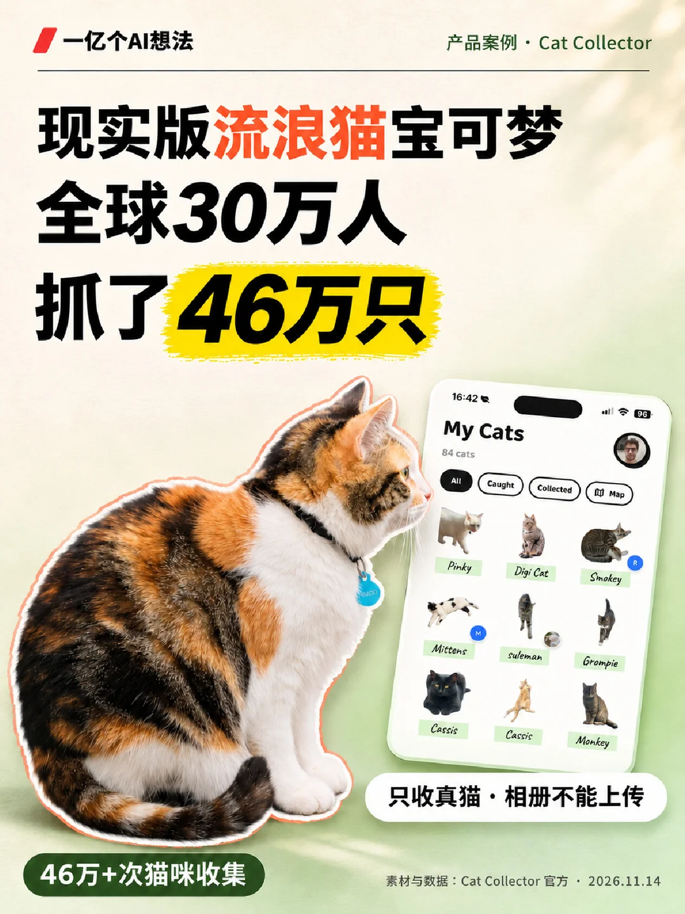
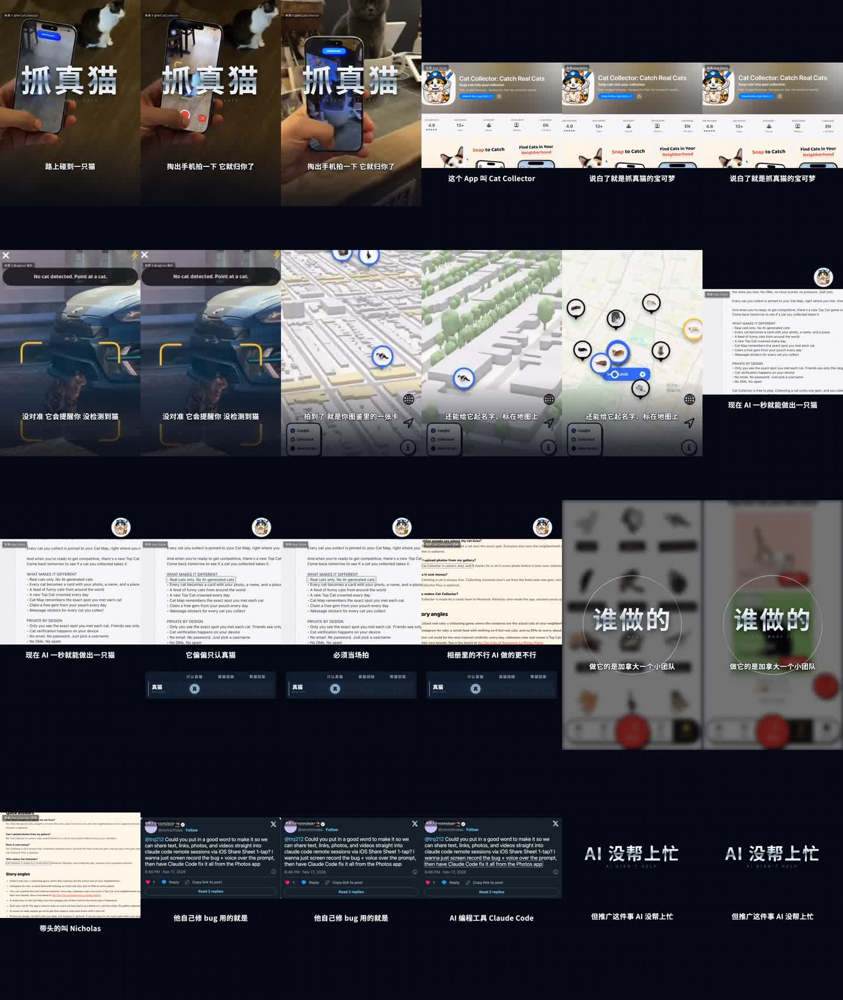

# 只收真猫的App，30万人抓了46万只猫

- 作者：一亿个AI想法
- 链接：https://xhslink.cn/o/8PZevr2910U
- 抓取：2026-11-20
- 标签：#AI应用 #独立开发 #撸猫 #流浪猫 #AI产品案例

## 正文

路上碰到一只猫，掏出手机拍一下，它就归你了。
	
这个 App 叫 Cat Collector，说白了就是抓真猫的宝可梦。拍到的猫会变成你图鉴里的一张卡，可以起名字、标在地图上。现在 AI 一秒就能做出一只猫，它偏偏只认真猫：必须用 App 里的相机当场拍，相册里的不行，AI 做的更不行。
	
做它的是加拿大蒙特利尔的一个小团队，带头的叫 Nicholas。他自己修 bug 也用 AI 编程工具 Claude Code，可推广这件事，AI 没帮上忙：AI 做的种草视频基本只有一千播放，他把第一条介绍视频反复重发，第二天冲到了两百五十万。
	
现在已经有三十万人，在一百九十三个国家，抓了四十六万只猫。前两天，它还冲到了台湾地区、香港地区 App Store 家庭游戏免费榜第一。
#AI应用[话题]#  #独立开发[话题]#  #撸猫[话题]#  #流浪猫[话题]#  #AI产品案例[话题]#

## 素材

关键帧：[frame-01.jpg](frame-01.jpg) [frame-02.jpg](frame-02.jpg) [frame-03.jpg](frame-03.jpg) [frame-04.jpg](frame-04.jpg) [frame-05.jpg](frame-05.jpg) [frame-06.jpg](frame-06.jpg) [frame-07.jpg](frame-07.jpg) [frame-08.jpg](frame-08.jpg) [frame-09.jpg](frame-09.jpg) [frame-10.jpg](frame-10.jpg) [frame-11.jpg](frame-11.jpg) [frame-12.jpg](frame-12.jpg) [frame-13.jpg](frame-13.jpg) [frame-14.jpg](frame-14.jpg) [frame-15.jpg](frame-15.jpg) [frame-16.jpg](frame-16.jpg) [frame-17.jpg](frame-17.jpg) [frame-18.jpg](frame-18.jpg) [frame-19.jpg](frame-19.jpg) [frame-20.jpg](frame-20.jpg) [frame-21.jpg](frame-21.jpg) [frame-22.jpg](frame-22.jpg) [frame-23.jpg](frame-23.jpg) [frame-24.jpg](frame-24.jpg)
[视频](video.mp4)

## 学到的（Claude 看完素材后填写，并同步到 AESTHETIC.md）

- 现实里当场拍到真猫 → 图鉴卡片 → 标在地图上；只认真猫。见 AESTHETIC.md 第 8 节。
