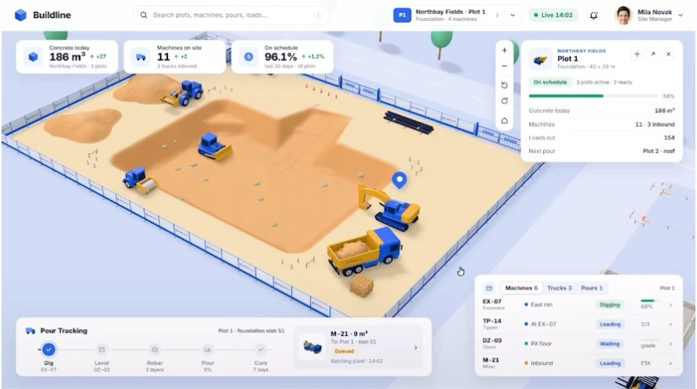
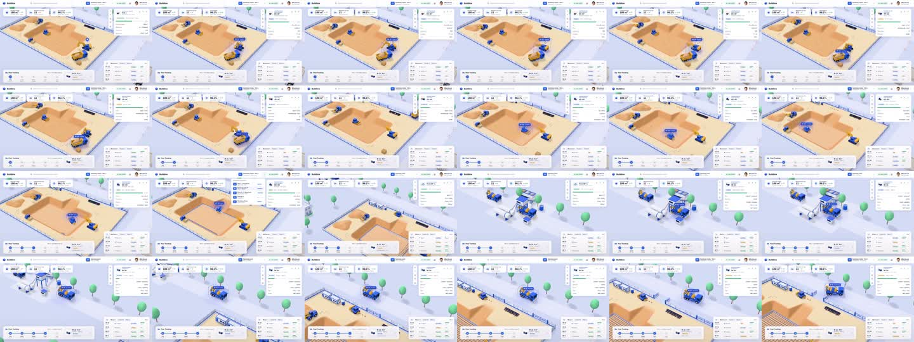

# 如果你一直想把任何行业变成一个实时模拟器

- 作者：未来鹰｜硅基猿AI资讯
- 链接：https://xhslink.cn/o/5iDBma7iVcG
- 抓取：2026-11-20
- 标签：#硅基猿AI #ai #ai工具 #ai学习 #人工智能

## 正文

如果你一直想把任何行业变成一个实时模拟器，那就看看这个。
	
有人为 Claude 做了一个免费的技能，它能构建 3D 模拟器，用它他完成了一个完整的作品：从光秃秃的土地到墙壁。
	
演示如何运作：
→ 挖掘机挖沟渠，卡车运走泥土
→ 搅拌机到来，浇筑混凝土板，进度实时上升
→ 在另外两栋房子上，你看到砌块墙在上升
→ 你点击每台机器，就能看到它在做什么
	
它有什么用：
→ 构建任何操作的演示，而无需手动建模一切
→ 看看 Claude Code 如何分配工作：2 个子代理和 3,829 行代码
#硅基猿AI[话题]# #ai[话题]# #ai工具[话题]# #ai学习[话题]# #人工智能[话题]#

## 素材

关键帧：[frame-01.jpg](frame-01.jpg) [frame-02.jpg](frame-02.jpg) [frame-03.jpg](frame-03.jpg) [frame-04.jpg](frame-04.jpg) [frame-05.jpg](frame-05.jpg) [frame-06.jpg](frame-06.jpg) [frame-07.jpg](frame-07.jpg) [frame-08.jpg](frame-08.jpg) [frame-09.jpg](frame-09.jpg) [frame-10.jpg](frame-10.jpg) [frame-11.jpg](frame-11.jpg) [frame-12.jpg](frame-12.jpg) [frame-13.jpg](frame-13.jpg) [frame-14.jpg](frame-14.jpg) [frame-15.jpg](frame-15.jpg) [frame-16.jpg](frame-16.jpg) [frame-17.jpg](frame-17.jpg) [frame-18.jpg](frame-18.jpg) [frame-19.jpg](frame-19.jpg) [frame-20.jpg](frame-20.jpg) [frame-21.jpg](frame-21.jpg) [frame-22.jpg](frame-22.jpg) [frame-23.jpg](frame-23.jpg) [frame-24.jpg](frame-24.jpg)
[视频](video.mp4)

## 学到的（Claude 看完素材后填写，并同步到 AESTHETIC.md）

- 等距 3D 施工现场模拟器 + 浅色仪表盘；见 AESTHETIC.md 第 8 节。
