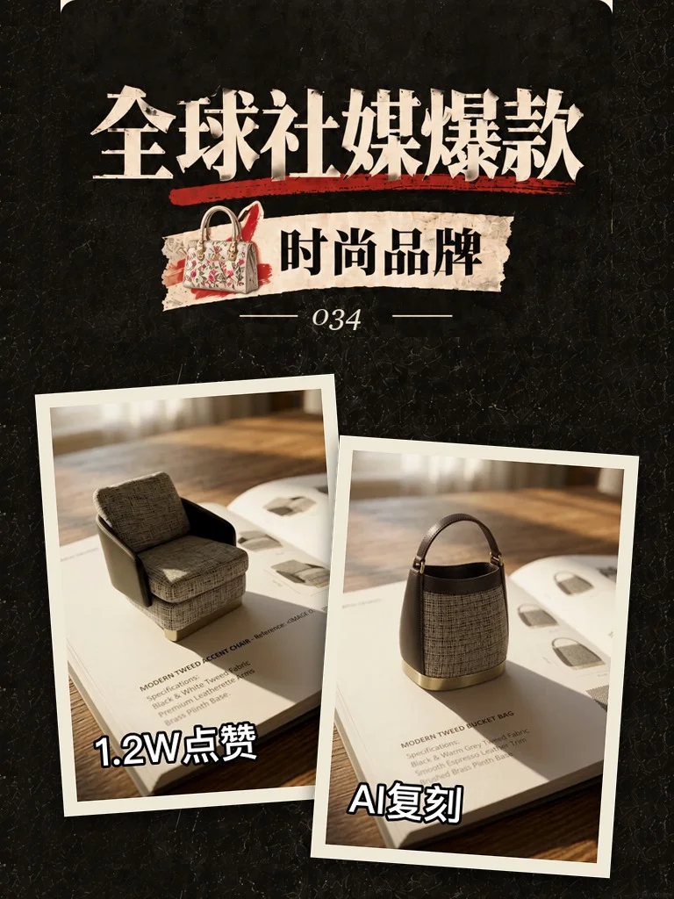
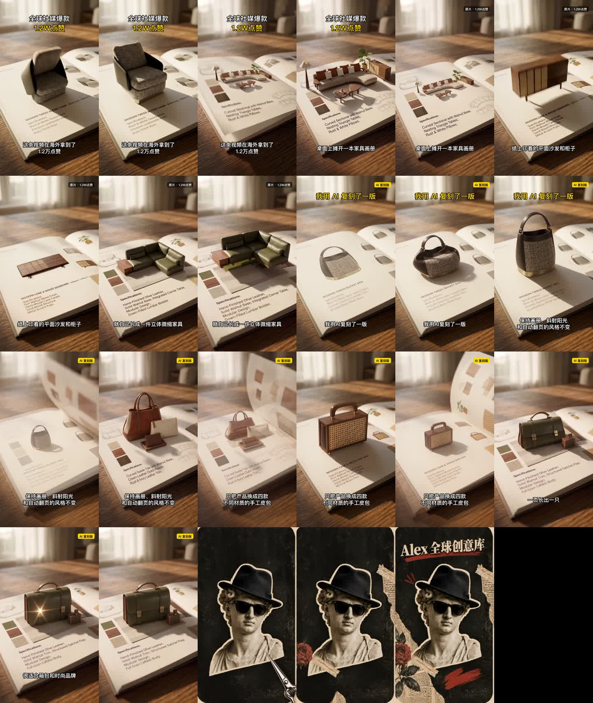

# 海外爆款分享 Part.034｜时尚品牌

- 作者：Alex全球创意库
- 链接：https://xhslink.cn/o/4M19ecAWlBP
- 抓取：2026-11-20
- 标签：#AI创意 #海外社媒 #广告创意 #产品营销 #创意灵感 #视觉冲击 #广告拆解 #品牌增长

## 正文

翻开画册，纸上印着的皮包一页一只自己立起来了👜✨
不用搭实景影棚也不用请模特，一页讲透一款单品的轮廓和材质，很适合箱包和时尚品牌做上新型录。
#AI创意[话题]# #海外社媒[话题]# #广告创意[话题]# #产品营销[话题]# #创意灵感[话题]# #视觉冲击[话题]# #广告拆解[话题]# #品牌增长[话题]#

## 素材

关键帧：[frame-01.jpg](frame-01.jpg) [frame-02.jpg](frame-02.jpg) [frame-03.jpg](frame-03.jpg) [frame-04.jpg](frame-04.jpg) [frame-05.jpg](frame-05.jpg) [frame-06.jpg](frame-06.jpg) [frame-07.jpg](frame-07.jpg) [frame-08.jpg](frame-08.jpg) [frame-09.jpg](frame-09.jpg) [frame-10.jpg](frame-10.jpg) [frame-11.jpg](frame-11.jpg) [frame-12.jpg](frame-12.jpg) [frame-13.jpg](frame-13.jpg) [frame-14.jpg](frame-14.jpg) [frame-15.jpg](frame-15.jpg) [frame-16.jpg](frame-16.jpg) [frame-17.jpg](frame-17.jpg)
[视频](video.mp4)

## 学到的（Claude 看完素材后填写，并同步到 AESTHETIC.md）

- 画册里的平面产品长成立体微缩实物；想用在说明书。
