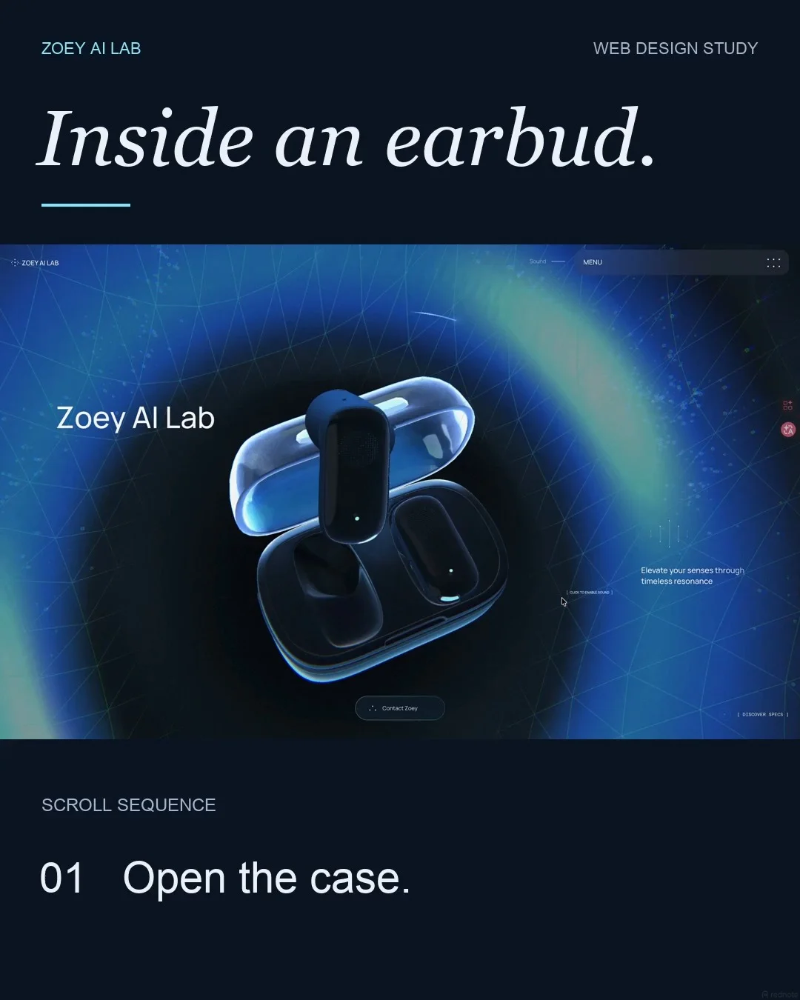
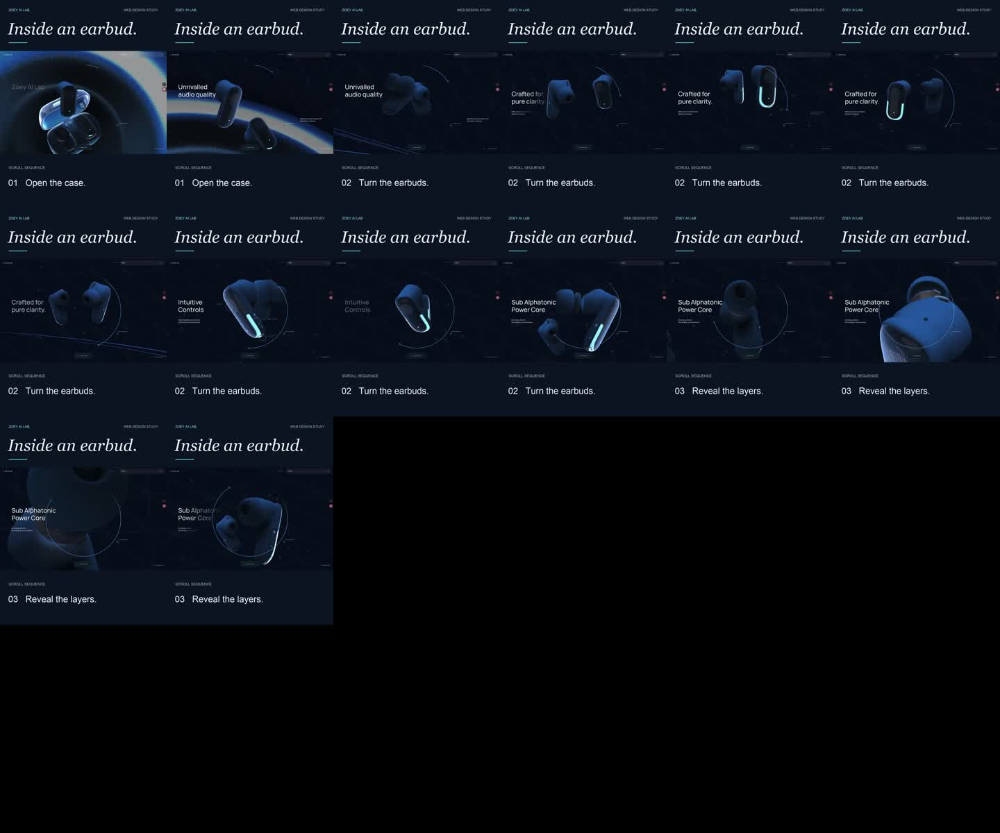

# 耳机概念

- 作者：Lim Zoey
- 链接：https://xhslink.cn/o/545xD6gXVnV
- 抓取：2026-11-20

## 正文

做这个耳机概念页时，我最想让人看到的是最后那一下：往下滑，耳机的零件一层层分开。
	
所以前面先留了两个视角。先看它放在充电盒里的样子，再转个角度看耳柄。等看到内部，才知道刚刚那一小块里面藏了什么。
	
如果换成你的产品，客人最常问「能不能拍近一点」的是哪个细节？
	
#网页设计 #产品展示 #交互设计 #马来西亚设计师

## 素材

关键帧：[frame-01.jpg](frame-01.jpg) [frame-02.jpg](frame-02.jpg) [frame-03.jpg](frame-03.jpg) [frame-04.jpg](frame-04.jpg) [frame-05.jpg](frame-05.jpg) [frame-06.jpg](frame-06.jpg) [frame-07.jpg](frame-07.jpg)
[视频](video.mp4)

## 学到的（Claude 看完素材后填写，并同步到 AESTHETIC.md）

- 滚动三幕：开盒 → 转动 → 爆炸图拆解。
