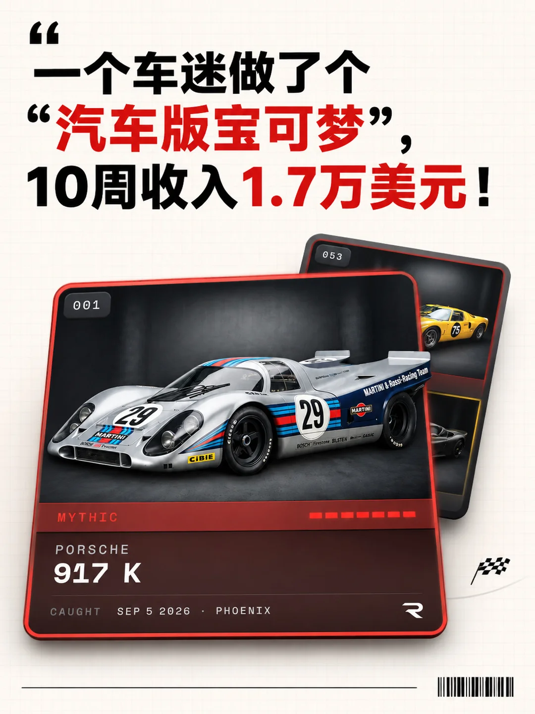
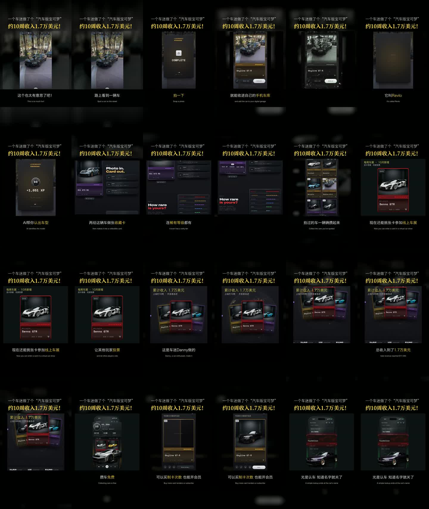

# 车迷做了个“汽车版宝可梦”，收入1.7万美金！

- 作者：逸蒙的赛博空间
- 链接：https://xhslink.cn/o/3VpqnHes5Nb
- 抓取：2026-11-20
- 标签：#vibecoding大赏 #AI赚钱案例 #AI游戏 #独立开发 #汽车收藏 #AI创业 #AI工具 #AI应用

## 正文

#vibecoding大赏[话题]# #AI赚钱案例[话题]# #AI游戏[话题]# #独立开发[话题]# #汽车收藏[话题]# #AI创业[话题]# #AI工具[话题]# #AI应用[话题]#

## 素材

关键帧：[frame-01.jpg](frame-01.jpg) [frame-02.jpg](frame-02.jpg) [frame-03.jpg](frame-03.jpg) [frame-04.jpg](frame-04.jpg) [frame-05.jpg](frame-05.jpg) [frame-06.jpg](frame-06.jpg) [frame-07.jpg](frame-07.jpg) [frame-08.jpg](frame-08.jpg) [frame-09.jpg](frame-09.jpg) [frame-10.jpg](frame-10.jpg) [frame-11.jpg](frame-11.jpg) [frame-12.jpg](frame-12.jpg) [frame-13.jpg](frame-13.jpg) [frame-14.jpg](frame-14.jpg) [frame-15.jpg](frame-15.jpg) [frame-16.jpg](frame-16.jpg) [frame-17.jpg](frame-17.jpg) [frame-18.jpg](frame-18.jpg) [frame-19.jpg](frame-19.jpg) [frame-20.jpg](frame-20.jpg) [frame-21.jpg](frame-21.jpg) [frame-22.jpg](frame-22.jpg) [frame-23.jpg](frame-23.jpg) [frame-24.jpg](frame-24.jpg)
[视频](video.mp4)

## 学到的（Claude 看完素材后填写，并同步到 AESTHETIC.md）

- 拍实物 → AI 识别 → 生成带稀有度的收藏卡（Photo in. Card out.）；见 AESTHETIC.md 第 8 节。
