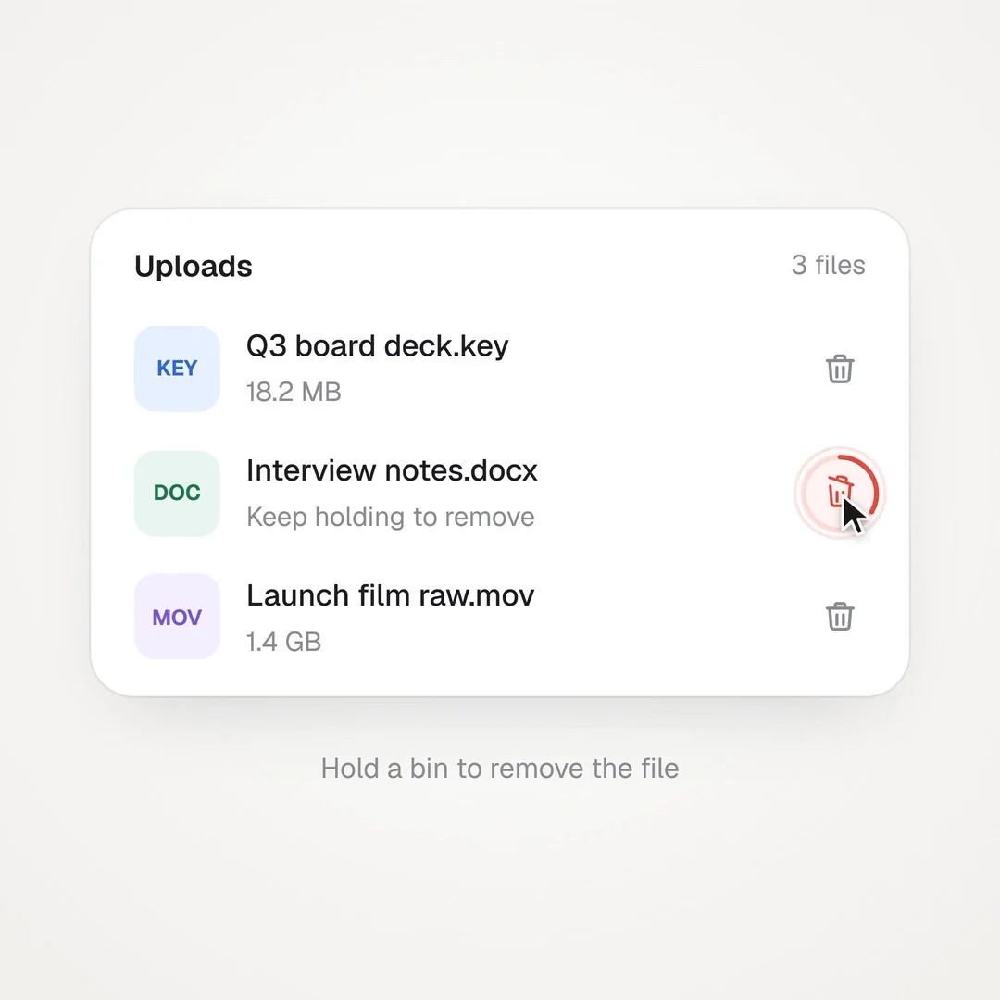
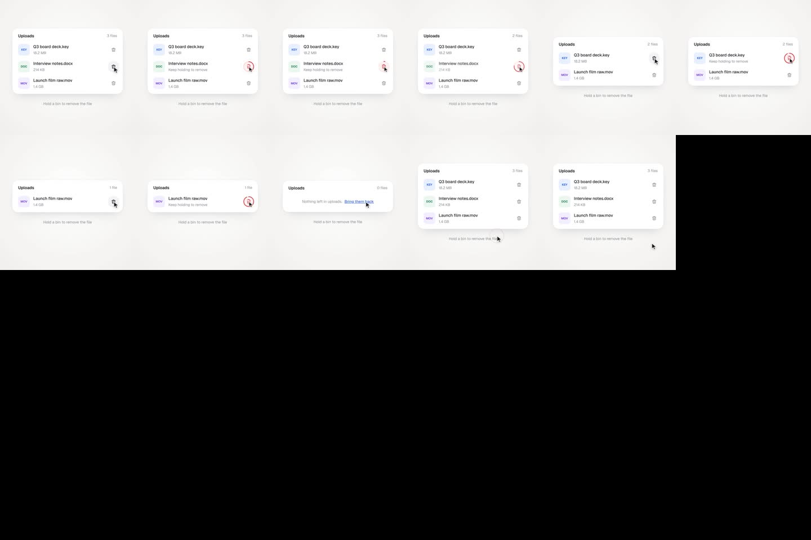

# 这个“删除”的交互方式对你有没有启发

- 作者：逸少UIUX
- 链接：https://xhslink.cn/o/4LyZRK0FLHo
- 抓取：2026-11-20
- 标签：#设计技巧 #设计干货 #交互设计 #用户体验设计 #UI界面设计

## 正文

#设计技巧[话题]# #设计干货[话题]# #交互设计[话题]# #用户体验设计[话题]# #UI界面设计[话题]#

## 素材

关键帧：[frame-01.jpg](frame-01.jpg) [frame-02.jpg](frame-02.jpg) [frame-03.jpg](frame-03.jpg) [frame-04.jpg](frame-04.jpg) [frame-05.jpg](frame-05.jpg) [frame-06.jpg](frame-06.jpg)
[视频](video.mp4)

## 学到的（Claude 看完素材后填写，并同步到 AESTHETIC.md）

- 长按垃圾桶、红色进度环走满才删除，删空可全部找回；演示 demos/hold-to-delete.html，见 AESTHETIC.md 第 8 节。
