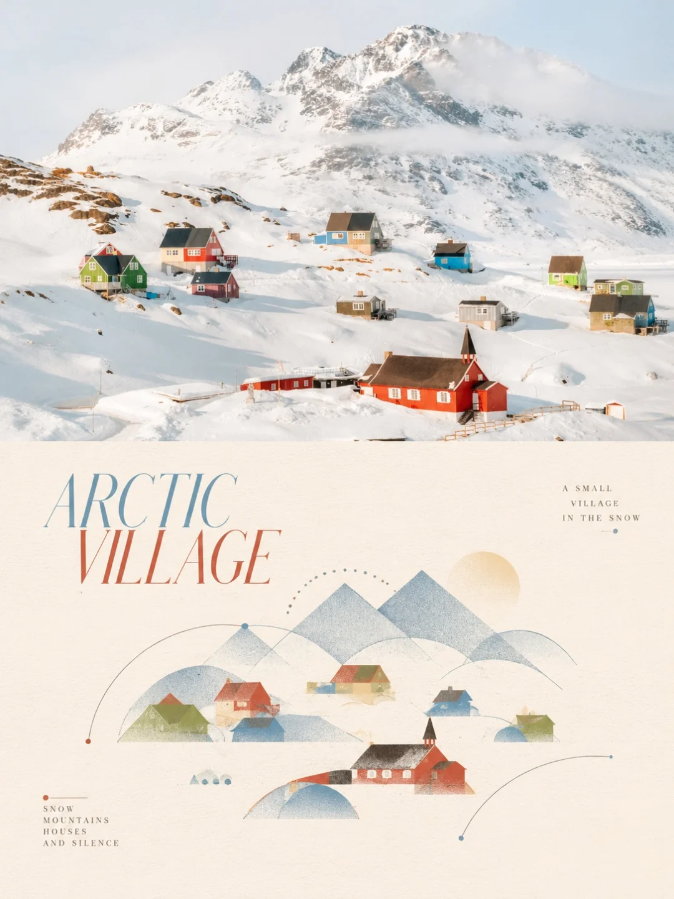
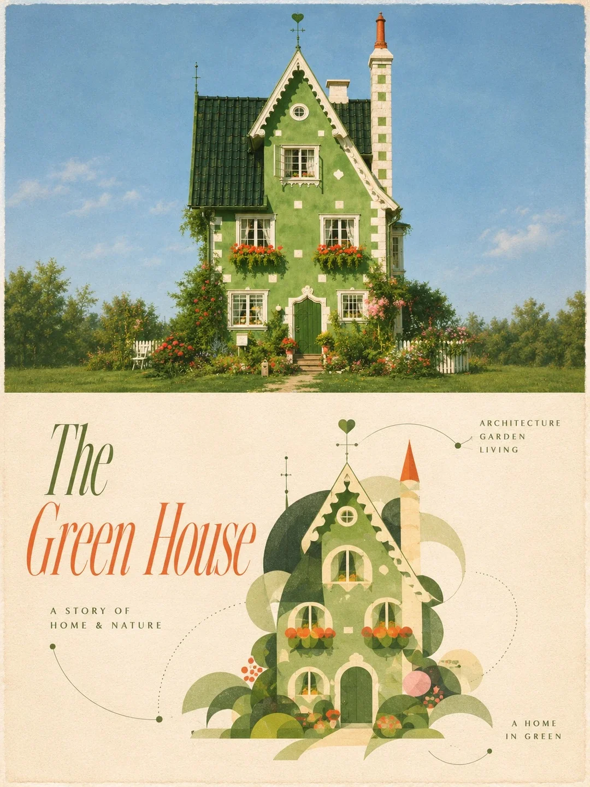
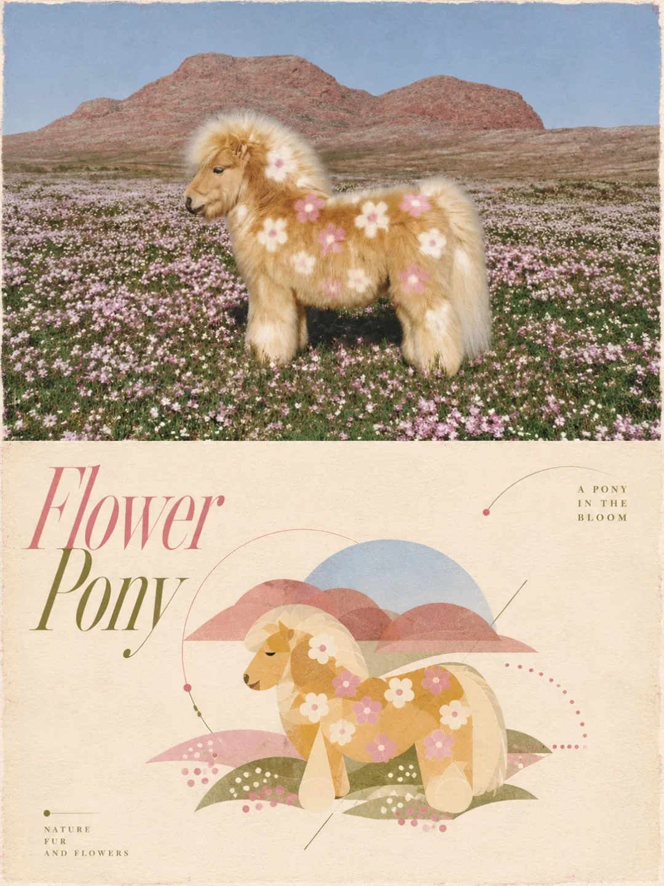
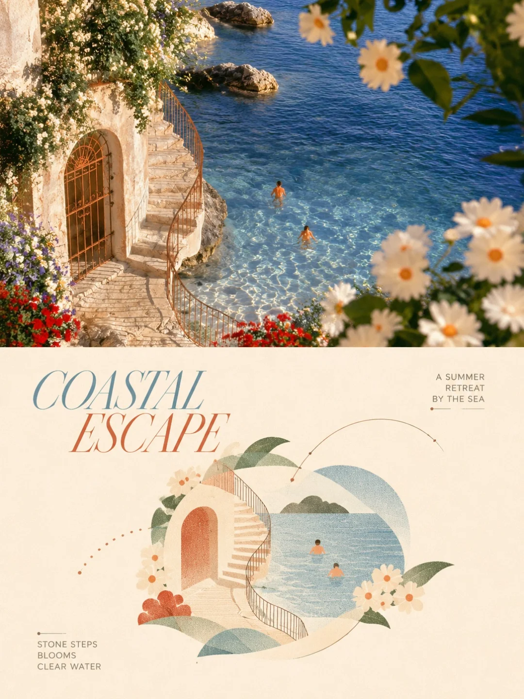
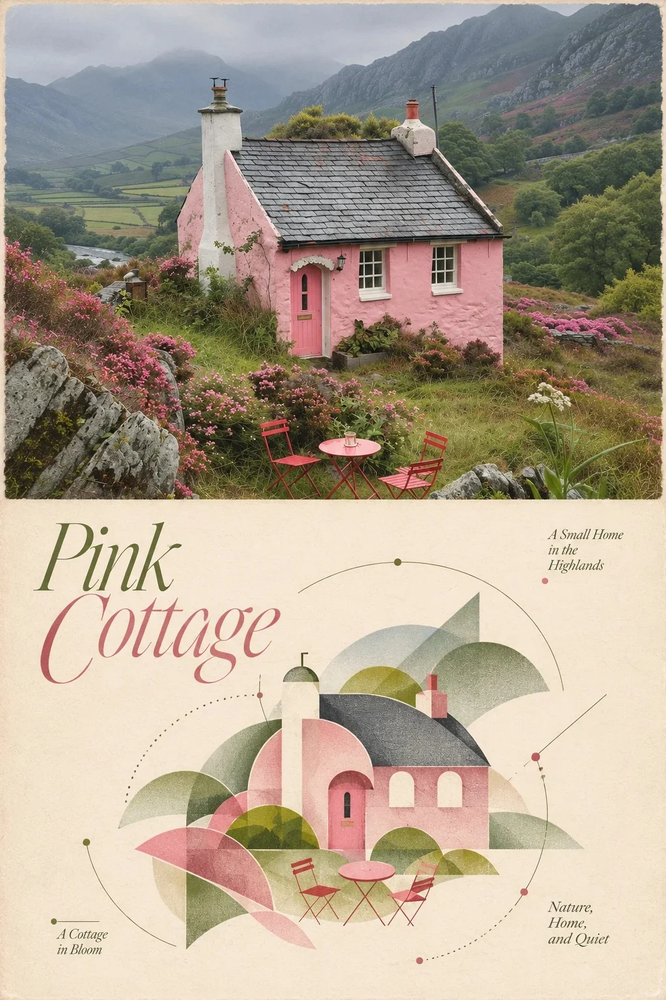

# 这个是提示词审美太赞了吧！

- 作者：Jennie_AI学习记
- 链接：https://xhslink.cn/o/8tChWX35mFv
- 抓取：2026-11-20
- 标签：#howto用好AI #AI生成 #ai关键词 #提升设计审美 #创意与灵感 #AI画图

## 正文

每天更新提示词
为上传的图片独立制作一张高级极简海报，不做拼接。上下两部分严格1:1，各占画面50%。 上半部分：保留原图主体身份、结构、姿态、真实质感、自然光影与色彩氛围，仅轻微高级调色，具艺术杂志与展览图像质感；可延展背景适配画幅，不拉伸扭曲改变主体，没有任何文字。 下半部分：将原图中的主体、轮廓、姿态、空间走势、环境、色彩、光影和视觉重心彻底拆解并重构为现代抽象几何艺术，保留原照的构图记忆与情绪联系，但不残留任何写实摄影区域，不是滤镜或几何覆盖照片。采用包豪斯、瑞士实验平面设计、复古独立艺术杂志与Risograph孔版印刷气质。核心几何组合整体缩小约70%，以约30%常规尺度形成精致集中的视觉中心，可依原照重心自由偏移；主体内部保持丰富的大中小层级结构，主体外部保留大面积暖白、米白或象牙白纸面留白。严格禁止矩形、正方形、方块拼贴、棋盘格、矩形网格及由线条围合出的直角框架。仅使用圆形、半圆、圆环、圆弧、扇形、椭圆、三角形、楔形、锥形、弯月形、不规则曲面、开放轮廓、缺口、细直线、虚线、曲线、节点、圆点、轨迹与负空间；所有形体、方向和细节必须源自原照，不添加无关图案。颜色从原照提取，以同色系明度变化建立层次，避免廉价渐变、霓虹色和杂乱高饱和配色。文字加入与照片内容相关、具有真实含义的1-4词英文艺术标题，标题由2种颜色组成，使用Edensor式纤细修长、高对比度衬线字体，自由非对称排版，可横向、纵向或错位、斜体，四周以少量英文辅助文字，不出现乱码、伪英文、水印或商业Logo。以少量细线、开放圆弧、点阵和结构节点连接主体与留白。纸面具有细腻温暖纤维、轻微Risograph颗粒、丝网印刷#howto用好AI[话题]# #AI生成[话题]# #ai关键词[话题]# #提升设计审美[话题]# #创意与灵感[话题]# #AI画图[话题]#

## 素材

## 学到的（Claude 看完素材后填写，并同步到 AESTHETIC.md）

- 几何拆解海报：纸面质感、包豪斯几何、细高斜体衬线双色标题；见 AESTHETIC.md 第 11 节。
