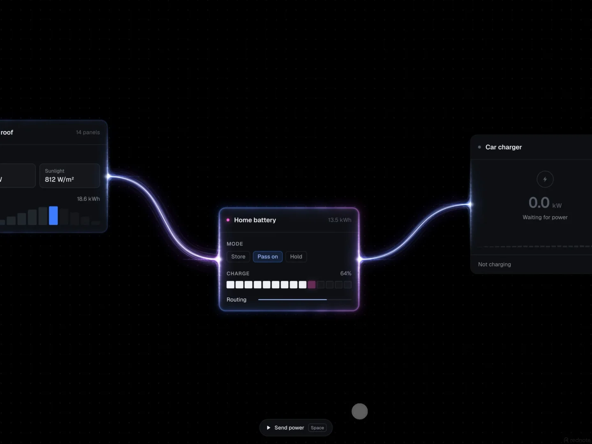
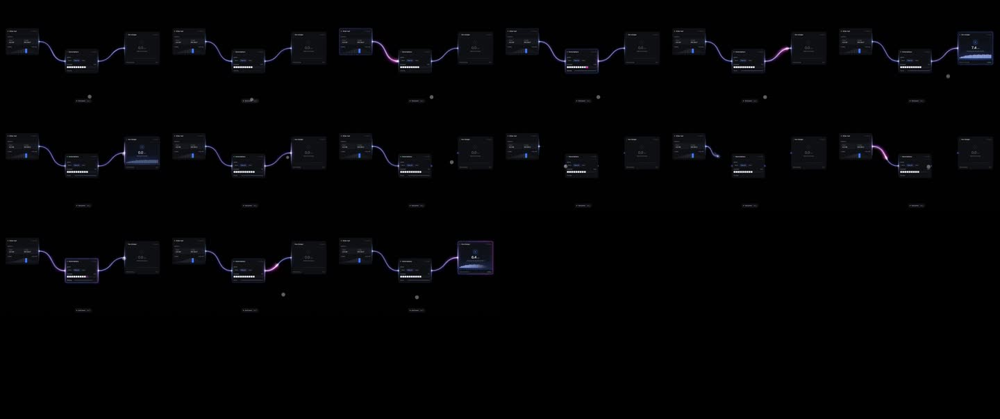

# 这束光跑过去的时候，简直神仙动效✨

- 作者：大厂劝退师
- 链接：https://xhslink.cn/o/1SPAtr1vjUQ
- 抓取：2026-11-20
- 标签：#交互设计 #UI动效 #节点编辑器 #设计灵感 #大厂劝退师 #动效设计 #WeeklyPick

## 正文

黑漆漆的画面里，三张卡片只靠两道细蓝线连着。点一下送电，左边的接头忽然亮起来。最亮的地方几乎是白的，边上晕着粉紫，拖着一截细细的尾巴，顺着弧线往下滑。
	
光一碰到中间的电池，卡片的边缘就亮了一圈。隔了一拍，另一束光从电池右边钻出来，沿着弧线往上走，把右边那张充电卡片也点亮了。等光跑过去，身后又只剩一道淡淡的蓝。
	
我最喜欢那一下一亮一暗。眼睛就跟着光先往下，再往上，忍不住想等它再跑一遍哈哈哈✨
	
视频来自 Anuar D.
	
#交互设计[话题]# #UI动效[话题]# #节点编辑器[话题]# #设计灵感[话题]# #大厂劝退师[话题]# #动效设计[话题]# #WeeklyPick[话题]#

## 素材

关键帧：[frame-01.jpg](frame-01.jpg) [frame-02.jpg](frame-02.jpg) [frame-03.jpg](frame-03.jpg) [frame-04.jpg](frame-04.jpg) [frame-05.jpg](frame-05.jpg) [frame-06.jpg](frame-06.jpg) [frame-07.jpg](frame-07.jpg) [frame-08.jpg](frame-08.jpg)
[视频](video.mp4)

## 学到的（Claude 看完素材后填写，并同步到 AESTHETIC.md）

- 节点之间跑光：白芯粉紫光沿弧线接力点亮卡片；演示 demos/power-beam.html；用于 AgentBoard。
