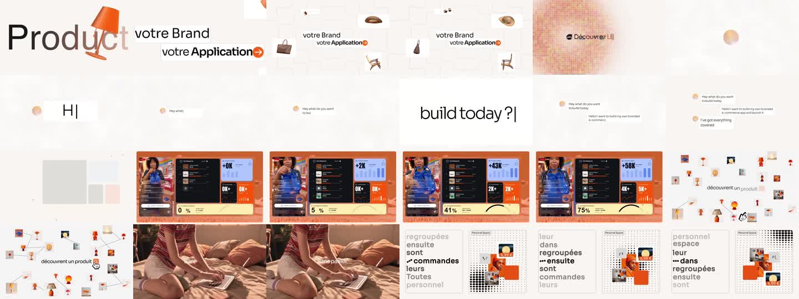

# 高级感UI交互，让产品视觉更有质感✨

- 作者：NEO商业动画制作
- 链接：https://xhslink.cn/o/sAiqF7e11W
- 抓取：2026-11-20
- 标签：#科技UI动画 #UI交互动画 #motion动效设计 #界面展示动画 #ae动画 #UIUX动效设计 #SaaS产品宣传片

## 正文

🎯 项目名称：Live Commerce 直播电商平台宣传片
✨ 简介：干净利落，动效丝滑！全新 Live Commerce 直播电商平台宣传片。以浅色基底配合高饱和橙色模块，通过打字机对话、商品节点关联与实时销售看板，直观展现无购物车下单与双端切换功能。
🛠 制作拆解：
1、分类：UI 界面动效 / 产品功能动画
2、流程：动态分镜设计→多图层卡片与数字递增绑定→节奏剪辑与音效匹配
3、软件：Illustrator + After Effects + Premiere
⏱ 制作周期：约2周
#科技UI动画[话题]#  #UI交互动画[话题]#  #motion动效设计[话题]#  #界面展示动画[话题]#  #ae动画[话题]#  #UIUX动效设计[话题]#  #SaaS产品宣传片[话题]#

## 素材

关键帧：[frame-01.jpg](frame-01.jpg) [frame-02.jpg](frame-02.jpg) [frame-03.jpg](frame-03.jpg) [frame-04.jpg](frame-04.jpg) [frame-05.jpg](frame-05.jpg) [frame-06.jpg](frame-06.jpg) [frame-07.jpg](frame-07.jpg) [frame-08.jpg](frame-08.jpg) [frame-09.jpg](frame-09.jpg) [frame-10.jpg](frame-10.jpg) [frame-11.jpg](frame-11.jpg) [frame-12.jpg](frame-12.jpg) [frame-13.jpg](frame-13.jpg) [frame-14.jpg](frame-14.jpg) [frame-15.jpg](frame-15.jpg) [frame-16.jpg](frame-16.jpg) [frame-17.jpg](frame-17.jpg) [frame-18.jpg](frame-18.jpg) [frame-19.jpg](frame-19.jpg) [frame-20.jpg](frame-20.jpg) [frame-21.jpg](frame-21.jpg) [frame-22.jpg](frame-22.jpg) [frame-23.jpg](frame-23.jpg) [frame-24.jpg](frame-24.jpg)
[视频](video.mp4)

## 学到的（Claude 看完素材后填写，并同步到 AESTHETIC.md）

- 学三块：剪切靠元素接力、产品介绍「问题 → 回答 → 证据 → 原理 → 场景」、浅白 + 橙色 + 实物小图的简约设计。见 AESTHETIC.md 第 8 节。
