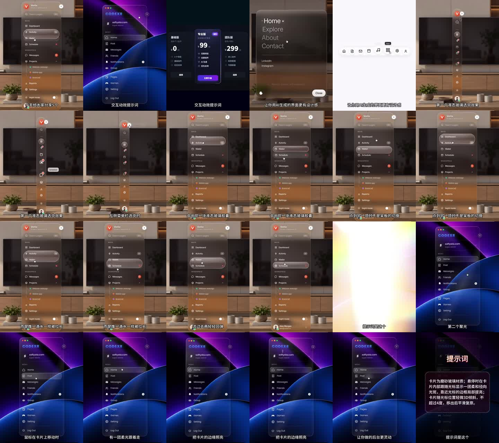

# AI新手村｜5个AI交互动效提示词直接复制可用

- 作者：短耳兔设计
- 链接：https://xhslink.cn/o/2nVhntcuXWr
- 抓取：2026-11-21
- 标签：#AI新手村 #UI设计 #AI玩家 #AI跟练玩家 #VibeCoding玩家 #vibecoding #howto用好AI #我这行的AI路 #交互设计

## 正文

#AI新手村[话题]# #UI设计[话题]# #AI玩家[话题]# #AI跟练玩家[话题]# #VibeCoding玩家[话题]# #vibecoding[话题]# #howto用好AI[话题]# #我这行的AI路[话题]# #交互设计[话题]# @科技薯 @艺术薯

## 素材

关键帧：[frame-01.jpg](frame-01.jpg) [frame-02.jpg](frame-02.jpg) [frame-03.jpg](frame-03.jpg) [frame-04.jpg](frame-04.jpg) [frame-05.jpg](frame-05.jpg) [frame-06.jpg](frame-06.jpg) [frame-07.jpg](frame-07.jpg) [frame-08.jpg](frame-08.jpg) [frame-09.jpg](frame-09.jpg) [frame-10.jpg](frame-10.jpg) [frame-11.jpg](frame-11.jpg) [frame-12.jpg](frame-12.jpg) [frame-13.jpg](frame-13.jpg) [frame-14.jpg](frame-14.jpg) [frame-15.jpg](frame-15.jpg) [frame-16.jpg](frame-16.jpg) [frame-17.jpg](frame-17.jpg) [frame-18.jpg](frame-18.jpg) [frame-19.jpg](frame-19.jpg) [frame-20.jpg](frame-20.jpg) [frame-21.jpg](frame-21.jpg) [frame-22.jpg](frame-22.jpg) [frame-23.jpg](frame-23.jpg) [frame-24.jpg](frame-24.jpg)
[视频](video.mp4)

## 学到的（Claude 看完素材后填写，并同步到 AESTHETIC.md）

- 10 个动效提示词，见 AESTHETIC.md 第 13 节；写法：材质 → 触发 → 怎么动 → 限度 → 结束状态。
