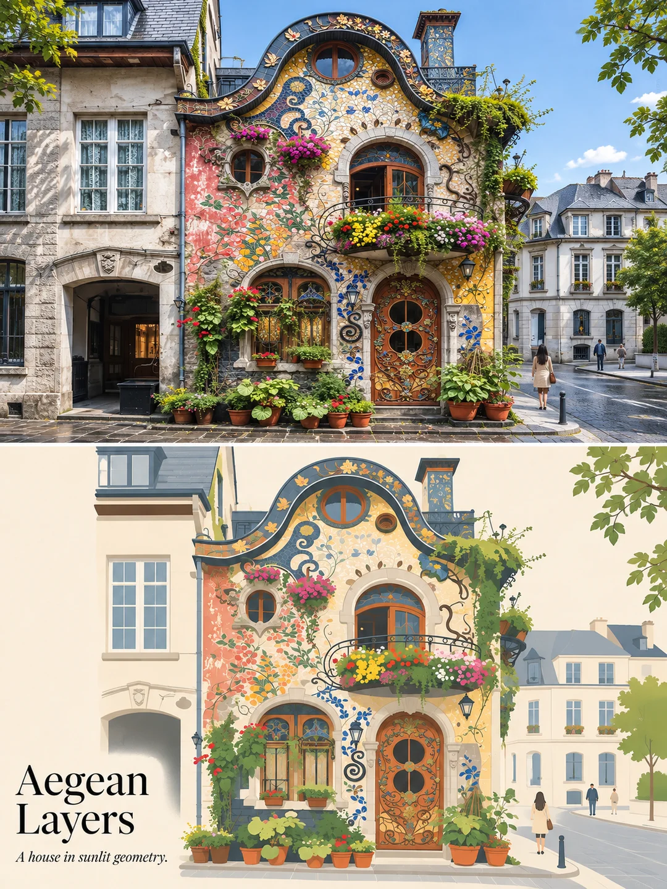
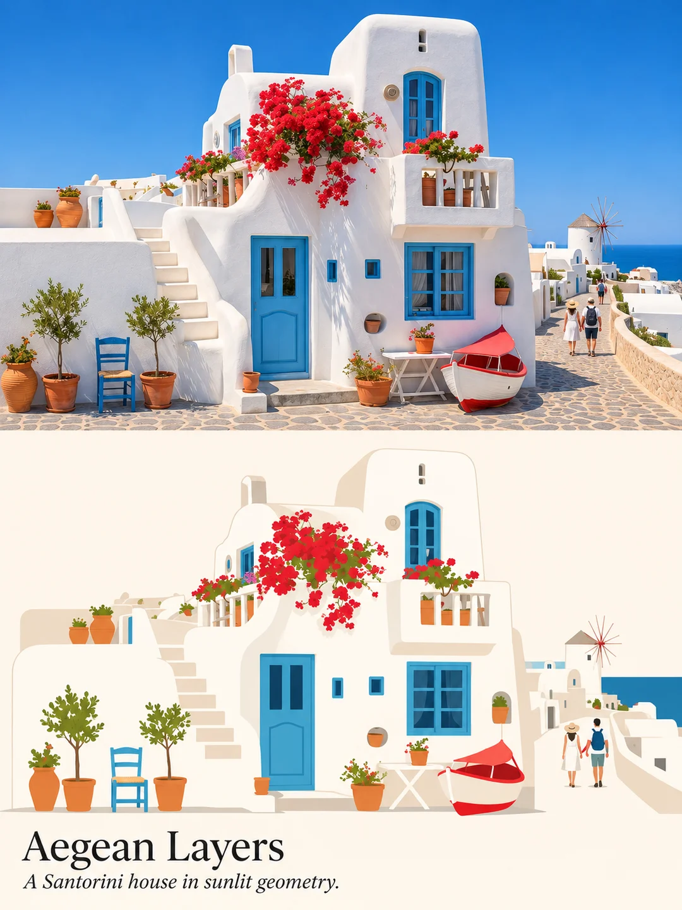
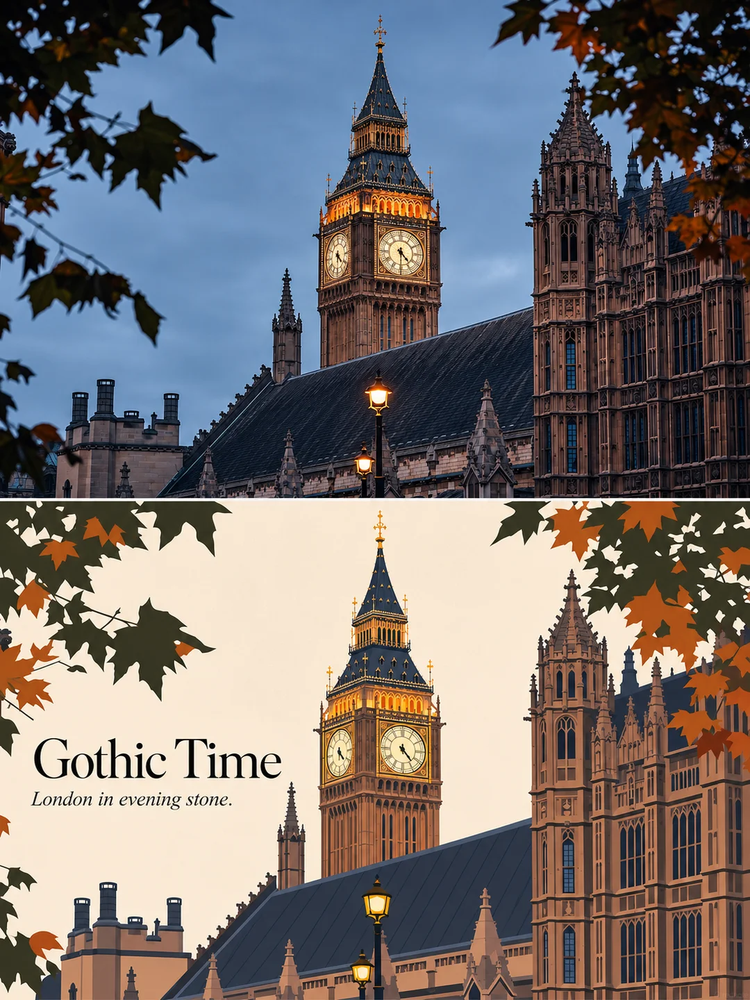
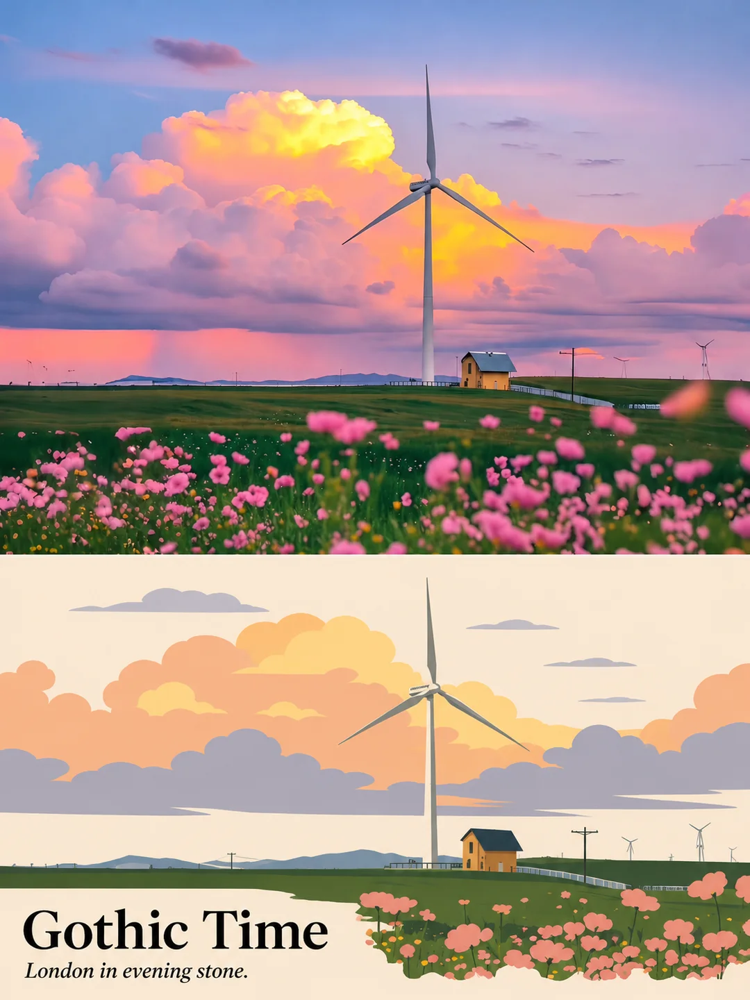
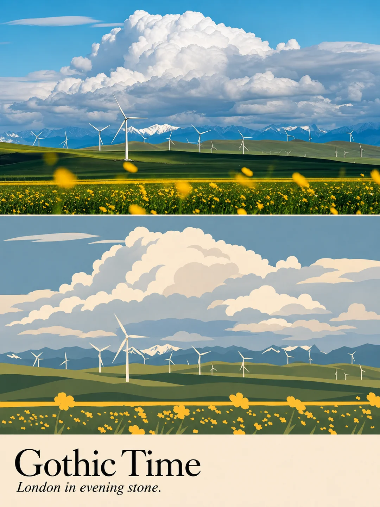

# AI新玩法19｜抽象插画

- 作者：林鹿AI日常
- 链接：https://www.xiaohongshu.com/discovery/item/6af6bbb9000000001802f992?app_platform=android&ignoreEngage=true&app_version=9.54.0&share_from_user_hidden=true&xsec_source=app_share&type=normal&xsec_token=CBOGmmeunrI_teFuS2F5YQh-bB-Cf3PNlRgg6Q4X6yK74%3D&author_share=1&xhsshare=CopyLink&shareRedId=ODo0Qkc2Oj42NzUyOTgwNjc1OTg2OTc-&apptime=1795252127&share_id=eba8e1cadca84221bc9f59805b0bcab4&share_channel=copy_link&track_code=3qOHe4W43oW
- 抓取：2026-11-21
- 标签：#AI进化生活howto #AIGC #aha这也是艺术 #AI画图

## 正文

提示词：
基于原图，生成一张3:4竖版现代作品海报。画面严格水平分为上下两半，以清晰直线分割。
上半部分：直接使用输入原图本身，不进行任何AI重绘、风格化、补景、删改、调色、裁切或内容替换。必须完整保留原图中的建筑、构图、视角、比例、光线、天空、树叶前景、钟楼、哥特式立面、屋顶、街灯与所有原始细节；上半部分应看起来与原始输入照片完全一致。
	
下半部分：仅根据上半部分原图，将同一建筑场景转换为精致扁平矢量插画。必须严格对应原图的镜头视角、钟楼位置与比例、右侧哥特式立面、斜向屋顶、街灯、天空留白，以及画面四角的树叶框景；不可改变建筑结构或重新设计场景。
	
下半部分背景为温暖米白纸张底色。用低饱和几何色块表现暮蓝天空、深蓝灰屋顶、深棕哥特石材、暖金色钟面与街灯、墨绿和赭褐色树叶。扁平插画只保留必要的建筑轮廓、窗洞、尖顶、时钟、屋顶和树叶剪影；无照片纹理、无渐变、无复杂写实阴影。
	
下半部分左下角加入大号优雅衬线英文标题“【英文标题，例如：Aegean Layers】”，下方加入小号斜体英文副标题“【英文副标题，例如：A house in sunlit geometry.】”。黑色排版，留白充足，现代建筑杂志与建筑作品集版式。
	
整体为高级建筑杂志与作品集版式。禁止修改上半部分原图；禁止水印、品牌标志、边框、UI按钮、播放图标、箭头、页码、中文文字和多余元素。
	
#AI进化生活howto[话题]# #AIGC[话题]# #aha这也是艺术[话题]# #AI画图[话题]#

## 素材

## 学到的（Claude 看完素材后填写，并同步到 AESTHETIC.md）

- 「上半原照 + 下半风格化重构」的第四个例子：下半是**严格同视角**的扁平矢量重绘，读者能上下对照找同一个窗、同一盏灯，这是好看的关键。
- 配色：暖米白纸底 + 从原照里抽出来、降饱和的几何色块；不用渐变和阴影，靠色块分层。
- 排版：左下大号衬线英文标题 + 小号斜体副标题，黑色，留白大，建筑杂志感。
- 五张图（花园洋房、圣托里尼、大本钟、风车花田、风车草原）都成立，说明这个提示词换题材也能用；但示例图里标题和画面对不上（风车配 Gothic Time），用的时候标题要按图改。
- 提示词全文见上方「正文」，也存进了图鉴条目 `abstract-architecture-poster`。
