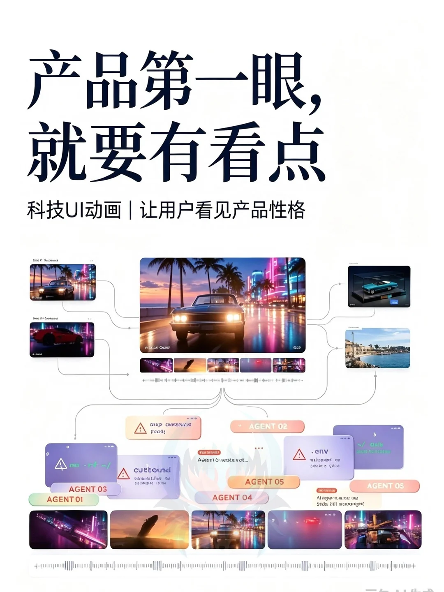
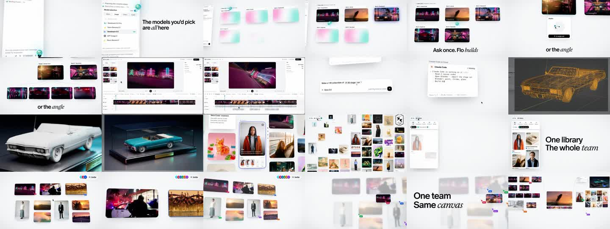

# UI交互动画‼️产品功能介绍要清晰易懂

- 作者：创意者科技UI动画
- 链接：https://xhslink.cn/o/67PhrTT62ec
- 抓取：2026-11-21
- 标签：#二维动画 #UI交互动画 #功能介绍 #软件宣传片 #交互设计 #APP宣传片 #科技动画 #小红书科技AMA #RED11月精选作者评选 #商业动画

## 正文

AI产品功能往往比较抽象，几张截图很难完整表达。
用一支动画串联核心功能、使用流程和应用场景，让用户快速看懂产品价值。
⊳
动画来源于网络，仅供制作参考展示。
#二维动画[话题]# #UI交互动画[话题]# #功能介绍[话题]# #软件宣传片[话题]# #交互设计[话题]# #APP宣传片[话题]# #科技动画[话题]# #商业动画[话题]# #小红书科技AMA[话题]# #RED11月精选作者评选[话题]#

## 素材

关键帧：[frame-01.jpg](frame-01.jpg) [frame-02.jpg](frame-02.jpg) [frame-03.jpg](frame-03.jpg) [frame-04.jpg](frame-04.jpg) [frame-05.jpg](frame-05.jpg) [frame-06.jpg](frame-06.jpg) [frame-07.jpg](frame-07.jpg) [frame-08.jpg](frame-08.jpg) [frame-09.jpg](frame-09.jpg) [frame-10.jpg](frame-10.jpg) [frame-11.jpg](frame-11.jpg) [frame-12.jpg](frame-12.jpg) [frame-13.jpg](frame-13.jpg) [frame-14.jpg](frame-14.jpg) [frame-15.jpg](frame-15.jpg) [frame-16.jpg](frame-16.jpg) [frame-17.jpg](frame-17.jpg) [frame-18.jpg](frame-18.jpg) [frame-19.jpg](frame-19.jpg) [frame-20.jpg](frame-20.jpg) [frame-21.jpg](frame-21.jpg) [frame-22.jpg](frame-22.jpg) [frame-23.jpg](frame-23.jpg) [frame-24.jpg](frame-24.jpg)
[视频](video.mp4)

## 学到的（Claude 看完素材后填写，并同步到 AESTHETIC.md）

- 拆成了视频配方：结构 12 拍、短句 + 一个斜体衬线词、漂浮卡片与无限画布、亮转暗收尾。见 AESTHETIC.md 第 12 节。
