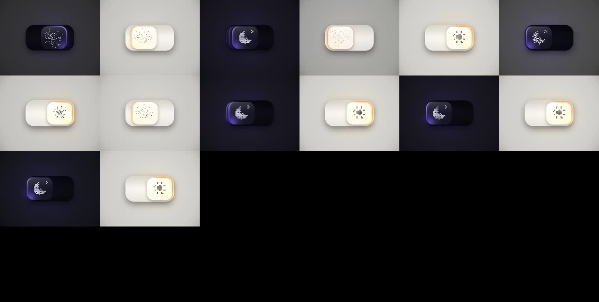

# deepseek 开关mothion动效

- 作者：坝上九步猫
- 链接：https://www.xiaohongshu.com/discovery/item/6b0167590000000016032124?app_platform=android&ignoreEngage=true&app_version=9.54.0&share_from_user_hidden=true&xsec_source=app_share&type=video&xsec_token=CBl-X_lZyj1sgNjjVPdEx48ykB5egrchz2Gicts_6NqOI%3D&author_share=1&xhsshare=CopyLink&shareRedId=ODo0Qkc2Oj42NzUyOTgwNjc1OTg2OTc-&apptime=1795257224&share_id=e2bb3549faa047eda6d8054ea3a634be&share_channel=copy_link&track_code=8NWLsFPS7Yf
- 抓取：2026-11-21
- 标签：#mothion #deepseek #动效设计 #动态设计 #图标设计 #产品动画

## 正文

开关mothion动效果 #mothion[话题]# #deepseek[话题]# #动效设计[话题]# #动态设计[话题]# #图标设计[话题]# #产品动画[话题]#

## 素材

关键帧：[frame-01.jpg](frame-01.jpg) [frame-02.jpg](frame-02.jpg) [frame-03.jpg](frame-03.jpg) [frame-04.jpg](frame-04.jpg) [frame-05.jpg](frame-05.jpg) [frame-06.jpg](frame-06.jpg) [frame-07.jpg](frame-07.jpg) [frame-08.jpg](frame-08.jpg) [frame-09.jpg](frame-09.jpg)
[视频](video.mp4)

## 学到的（Claude 看完素材后填写，并同步到 AESTHETIC.md）

- 胶囊开关 + 方块点阵图标：夜（深靛底、白点月亮、紫色光晕）↔ 日（暖白底、深灰点太阳、暖橙光晕）。
- 心动点：图标切换时点阵**散成粒子、跟着滑块走、再聚成新图标**，同时整屏日夜一起换。
- 节奏：一次切换约 0.8–1 秒；粒子飞散最散的时刻在滑块走到一半时。
- 视频 14.4 秒，夜→日→夜循环两次。
