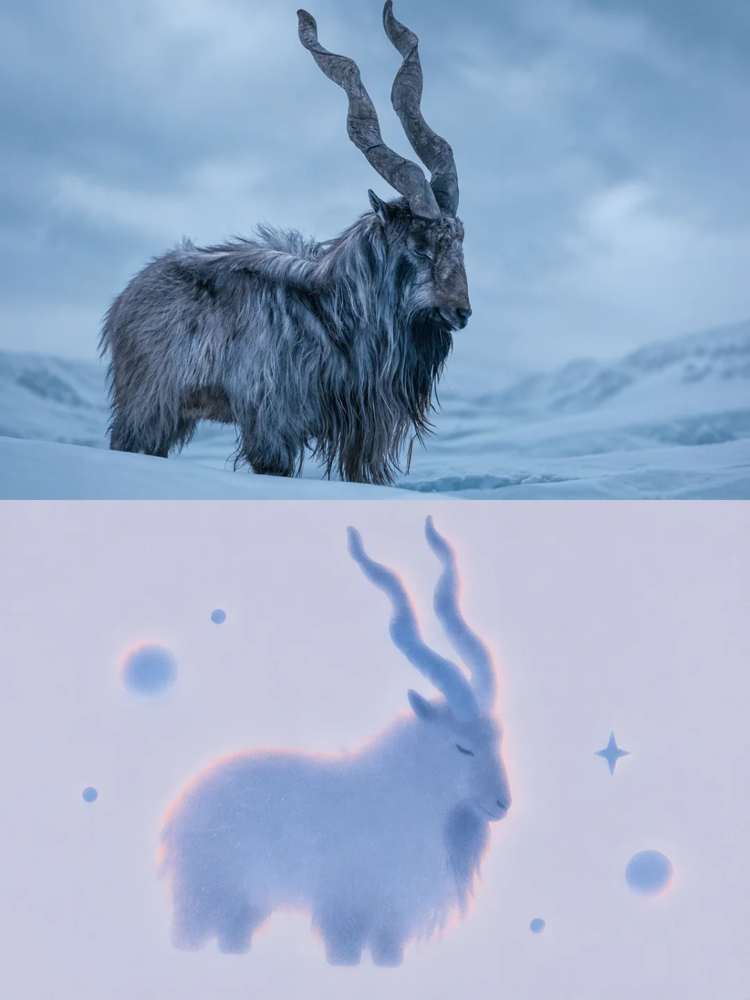
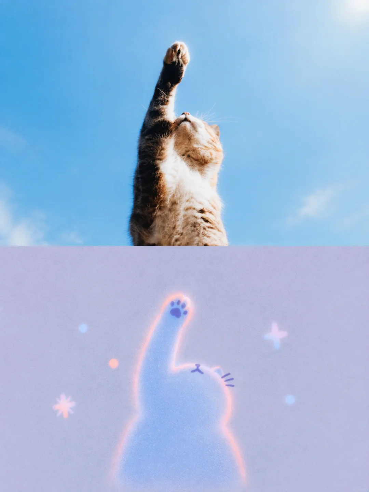
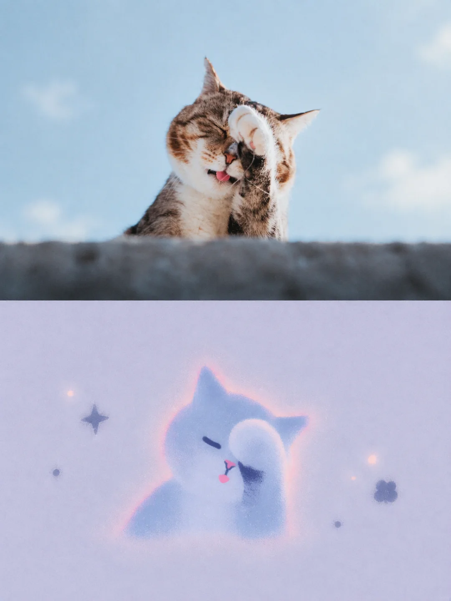
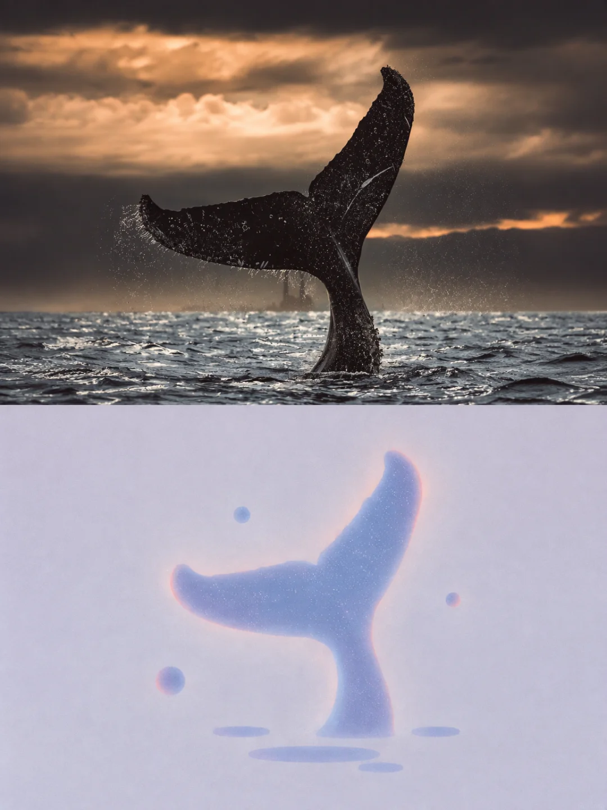
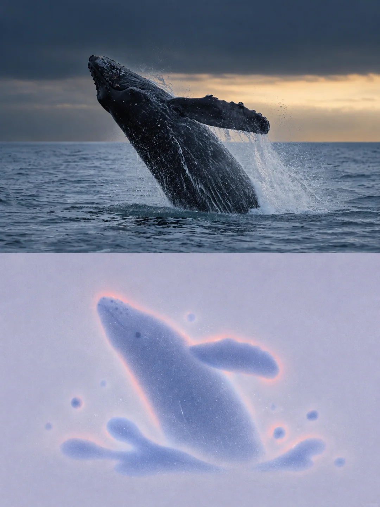
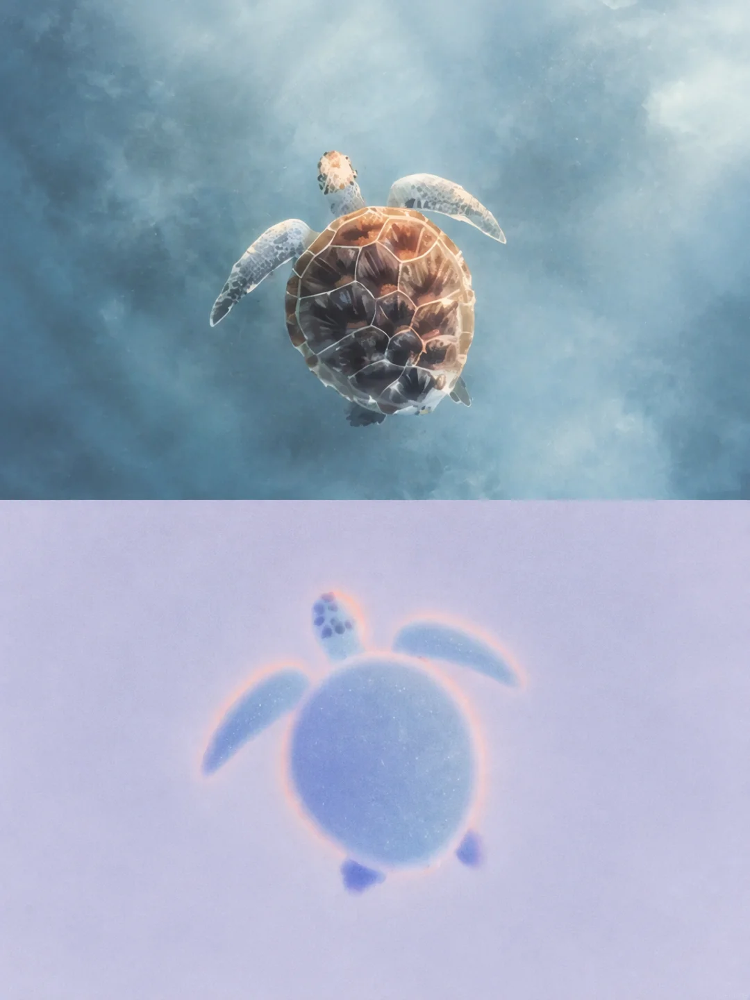
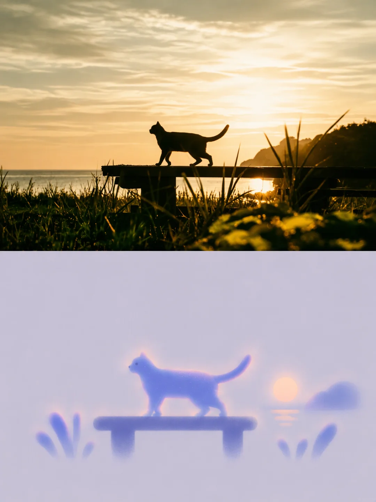
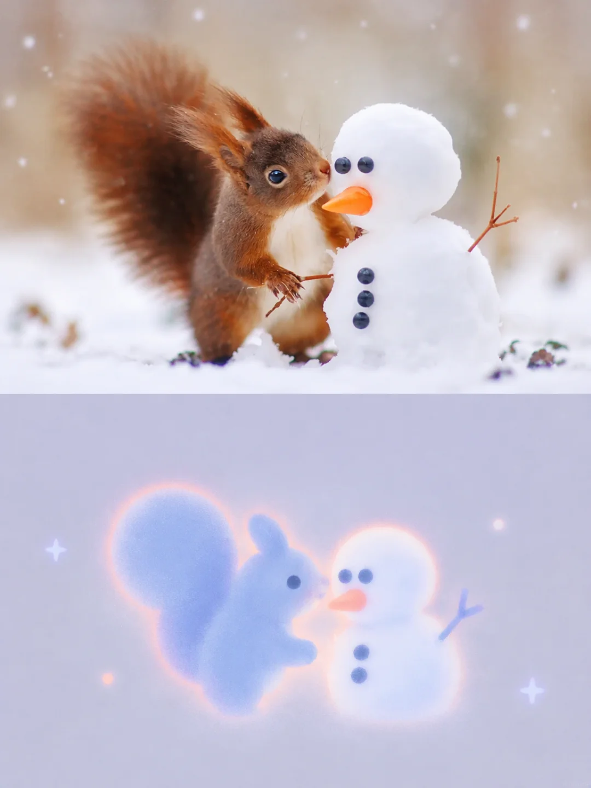
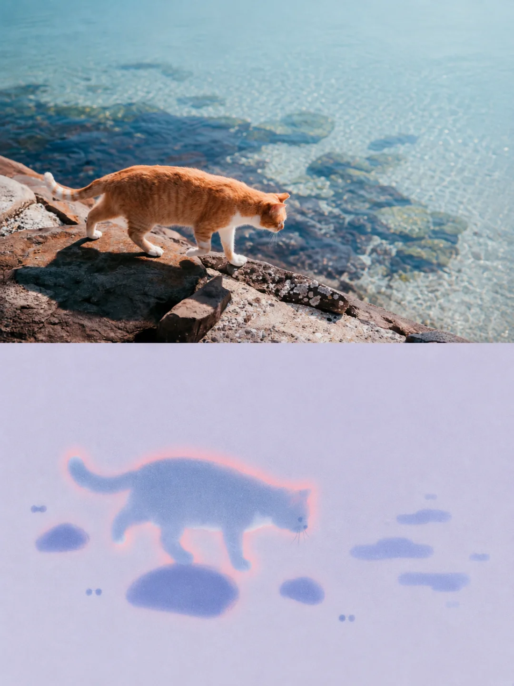

# 发现新的视觉流行风格

- 作者：Vaeen Ai Design
- 链接：https://xhslink.cn/o/3QPGnjYxQcW
- 抓取：2026-11-21
- 标签：#aha这也是艺术 #我这行的AI路 #HOWTO #AI新手村 #ai关键词 #ai工具 #审美积累 #AI新生 #小红书设计周 #设计生长

## 正文

提示词：为上传的图片制作一张海报，不做拼接。上下两部分严格1:1，各占画面50%。
上半部分：保留原照主体身份、结构、姿态、真实质感、自然光影与色彩氛围，仅轻微高级调色，具艺术杂志与展览图像质感；可延展背景适配画幅，不拉伸扭曲改变主体，没有任何文字。
下半部分：低对比冷紫底柔焦荧光颗粒符号插画风格，以少量独立、圆钝、比例略显幼态的简化形体概括内容，只保留平滑外轮廓、基础姿态和极少数深色识别标记；全部删除写实体积、复杂结构、毛发、羽毛、皮肤纹理、布料褶皱、反光、高光、投影和背景细节，不保留任何精细刻画。采用大面积淡灰紫负形留白，多个中小尺度形体疏朗错落分布，保持宽阔且均匀的周围空白，不放大主体、不填满画面、不改变稀疏的呼吸感与视觉重心；整体以低频平滑曲线和圆润钝角构成，轮廓边缘不锐利，略带柔化扩散与轻微失焦，造型左右稳定但允许姿态存在小幅差异，内部信息预算极低。主体大形体使用低饱和雾蓝色局部填色，覆盖主要内部区域但不形成清晰硬边或立体渐变，深靛蓝仅用于少量局部符号和边缘强调，浅珊瑚粉以极窄、朦胧的外缘光晕贴合轮廓，不扩散成大色块；色彩通过柔焦、叠色和轻微色散产生自然过渡，避免纯黑统一描边。表面保留非常细密、低对比、均匀分布的微小亮点颗粒，仅作为淡蓝填色内部的弱质感，强度克制，不覆盖轮廓，不转化为短线排线或粗糙噪点；边缘可有轻微蓝紫与粉色错位、柔和晕染和模拟低清扫描般的光学扩散，但整体保持平面化、低饱和、低反差。禁止锐利矢量边缘、硬朗几何转角、完整写实填充、强烈明暗塑形、立体渲染、复杂材质、密集纹理、尖刺状轮廓、断裂干笔、细碎毛发式笔触、过度清晰的背景、满版装饰和额外文字。
@小红书设计周 @设计薯 @艺术薯 @HOWTO薯
#aha这也是艺术[话题]# #我这行的AI路[话题]# #HOWTO[话题]# #AI新手村[话题]# #ai关键词[话题]##ai工具[话题]# #审美积累[话题]# #AI新生[话题]# #小红书设计周[话题]# #设计生长[话题]#

## 素材

## 学到的（Claude 看完素材后填写，并同步到 AESTHETIC.md）

- 上原照下柔焦冷紫符号插画；确认「上原照 + 下重构」海报格式。见 AESTHETIC.md 第 11 节。
