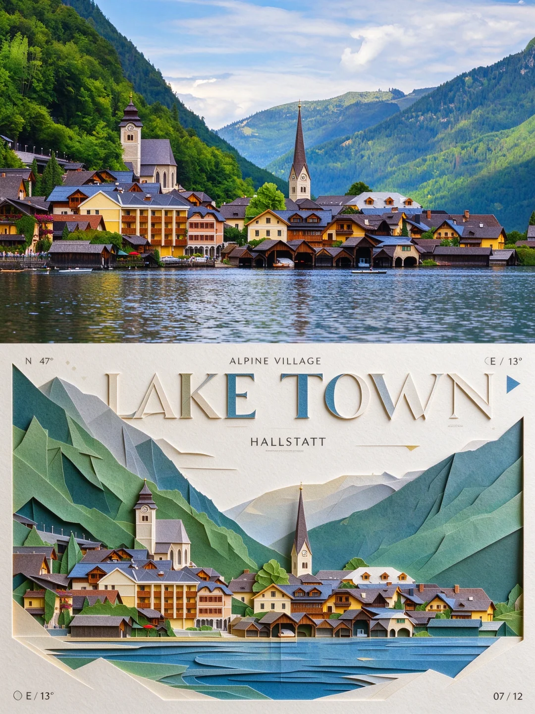
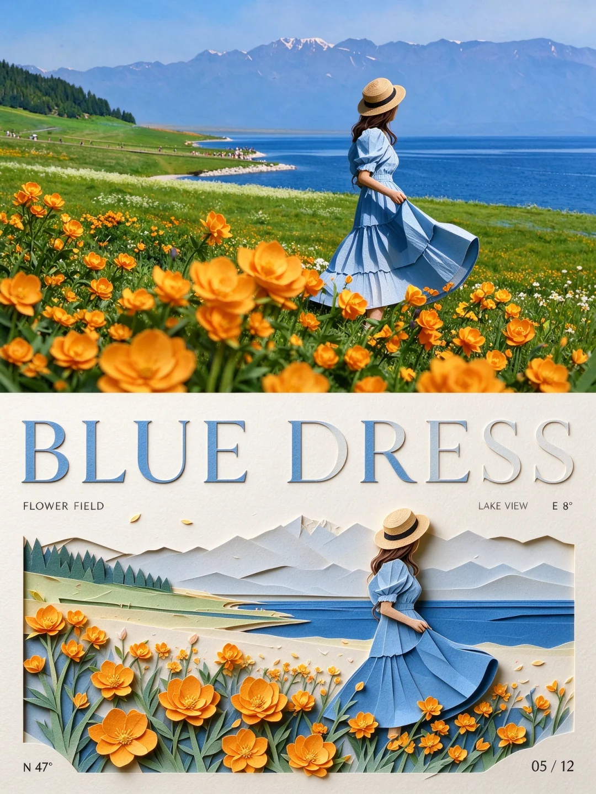
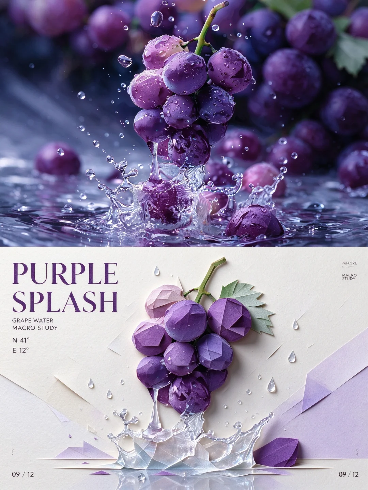
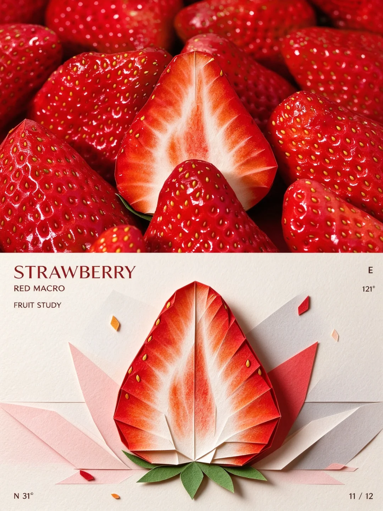
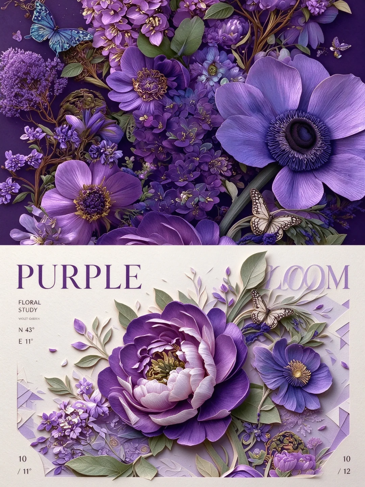
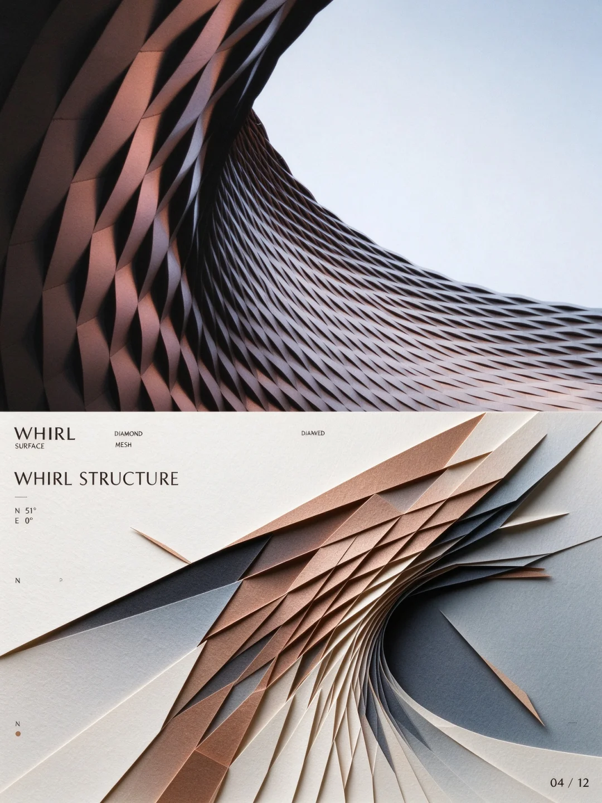
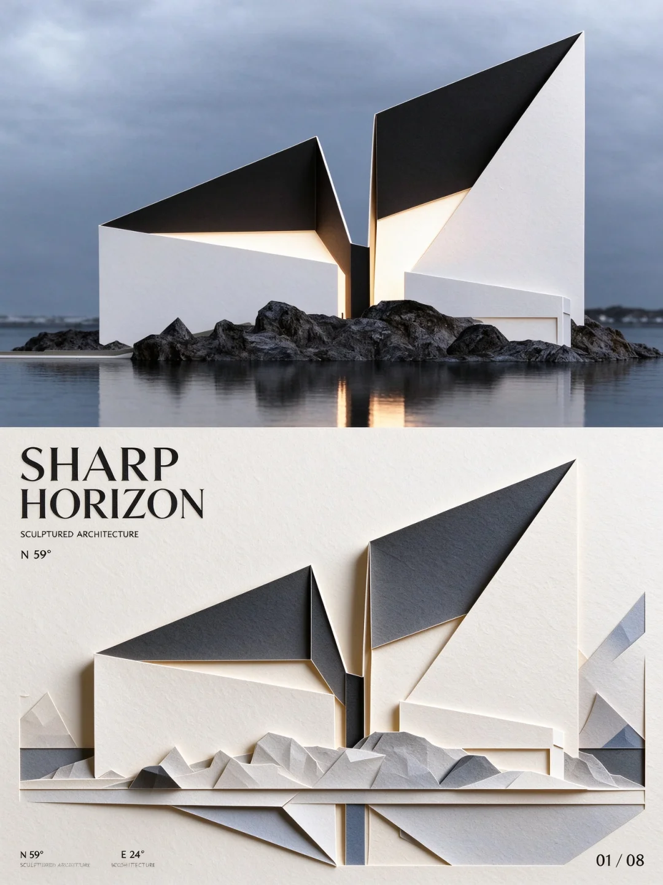

# 实拍×纸雕重构｜上下分版艺术海报

- 作者：胡茬の大叔
- 链接：https://www.xiaohongshu.com/discovery/item/6af2c4fa000000002a0273c3?app_platform=android&ignoreEngage=true&app_version=9.54.0&share_from_user_hidden=true&xsec_source=app_share&type=normal&xsec_token=CByK-XrB9C2bfrypFoCku6ENR7ZFtQ9GNM7KbRhgwZ6RA%3D&author_share=1&xhsshare=CopyLink&shareRedId=ODo0Qkc2Oj42NzUyOTgwNjc1OTg2OTc-&apptime=1795258530&share_id=7abc148bf9bf4116b8269c3e54538724&share_channel=copy_link&track_code=6iflAgC46F9
- 抓取：2026-11-21
- 标签：#平面设计 #AI提示词 #艺术创作 #创意海报 #拼贴风 #设计灵感 #设计灵感 #马路生活节

## 正文

为每张上传照片独立制作一张高端设计海报，禁止拼接合成，单图单海报。3:4竖版构图，画面沿高度严格1:1上下对半分割，上下区域各占50%画布高度。
【上半区】保留原图主体，维持主体结构、轮廓比例、姿态、纹理、自然光影与原生色彩氛围，仅做克制高级的杂志级摄影调色，达到艺术出版物、展览摄影质感；背景可自然延展补全，主体严禁拉伸、变形、改动。
【下半区】提取原图辨识度最高的主体轮廓、动态姿态、色彩基调、画面叙事关系，转译为精致立体纸雕拼贴作品。不机械复刻照片细节，依靠折面、切面、叠层嵌套、纸片组合、正负形裁切简化造型，一眼可识别原型，带有清晰几何结构与真实手工纸艺雕塑感。 下半区构图不强制居中，依照主体视觉重心、轮廓走向、体量、动势排布；依靠层级遮挡、大小对比、斜向张力、留白、正负形塑造视觉节奏，主体可偏置、局部裁切延伸；辅助纸片、几何装饰只做衬托，不能形成第二个视觉焦点，大面积留白营造松弛呼吸感，兼顾现代版式克制平衡。 色彩：从上半实拍画面提取标志性主色，生成适配纸雕的和谐色调；依靠同色系明暗、邻近色、少量对比色区分折面层级与空间纵深；背景选用米白、浅灰、低饱和浅底色，大面积留白，仅点缀细微纸纹、极简几何碎片。 光影：柔和漫射柔光，着重表现纸纤维肌理、锋利折痕、裁切毛边、纸张厚度、层叠自然投影，画面干净细腻，拒绝塑料CG反光、廉价卡纸质感。
【文字标题规则】自动生成贴合画面主题的简约英文主标题（单词/短词组，贴合图片景物），搭配一行极简短英文注释；主标题直接做成纸雕构件，和纸雕造型融合一体，可沿轮廓排布、弧形环绕、轴线延伸、悬浮留白处，文字清晰可读，是画面结构的一部分，不是后期叠加浮字；辅助注释字体简约纤细，篇幅极短，克制不抢视觉重心。 整体调性：当代纸雕艺术+高级版式设计，突出纸材质感、几何精度、空间层次、手工温度；实拍上半部分和纸雕下半部分拥有强关联、巧妙呼应。 禁止：卡通折纸、童趣风格、死板对称构图、元素堆砌、电商海报、模板化设计、塑料三维渲染、强反光CG、水印、文字错乱、主体变形、多图拼接。
	
#平面设计[话题]# #AI提示词[话题]# #艺术创作[话题]# #创意海报[话题]# #拼贴风[话题]# #设计灵感[话题]# #设计灵感[话题]#  #马路生活节[话题]#

## 素材

## 学到的（Claude 看完素材后填写，并同步到 AESTHETIC.md）

- 上半原照，下半立体纸雕；纸雕看得到纤维、折痕、毛边、厚度、层间投影，像真的手工作品。
- 标题是纸雕构件，不是浮在上面的字；角落有坐标、编号、分类小字，像画册目录。
- 七张示例：湖边小镇、蓝裙女孩、紫葡萄、草莓、紫花、建筑曲面、白色建筑，题材差别很大都成立。
- 我说「这个很顶」：评为最爱。
