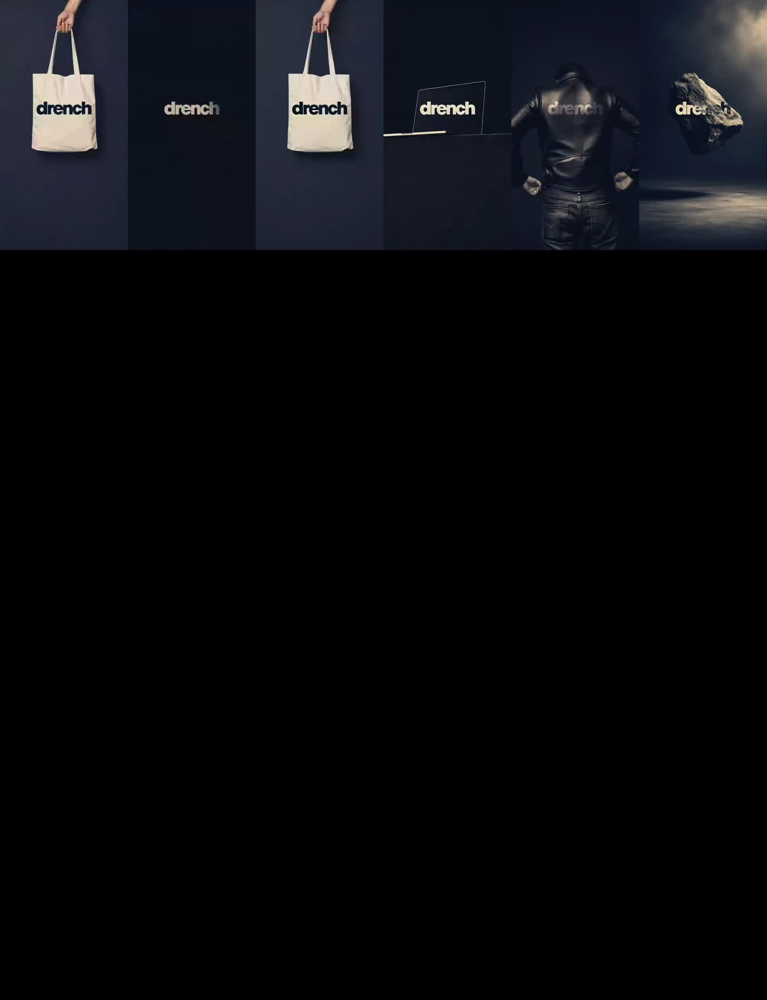

# 审美积累|极简板式变化

- 作者：曹小阳
- 链接：https://xhslink.cn/o/Ajyqnujbaj6
- 抓取：2026-11-21
- 标签：#编排设计 #文字编排 #版式设计 #品牌设计 #字体设计 #设计 #设计灵感 #没有天赋那就反复 #审美提升

## 正文

#编排设计[话题]# #文字编排[话题]# #版式设计[话题]# #品牌设计[话题]# #字体设计[话题]# #设计[话题]# #设计灵感[话题]# #没有天赋那就反复[话题]##设计[话题]##审美提升[话题]#

## 素材

关键帧：[frame-01.jpg](frame-01.jpg) [frame-02.jpg](frame-02.jpg) [frame-03.jpg](frame-03.jpg) [frame-04.jpg](frame-04.jpg) [frame-05.jpg](frame-05.jpg) [frame-06.jpg](frame-06.jpg) [frame-07.jpg](frame-07.jpg) [frame-08.jpg](frame-08.jpg) [frame-09.jpg](frame-09.jpg) [frame-10.jpg](frame-10.jpg) [frame-11.jpg](frame-11.jpg) [frame-12.jpg](frame-12.jpg) [frame-13.jpg](frame-13.jpg) [frame-14.jpg](frame-14.jpg) [frame-15.jpg](frame-15.jpg) [frame-16.jpg](frame-16.jpg) [frame-17.jpg](frame-17.jpg) [frame-18.jpg](frame-18.jpg) [frame-19.jpg](frame-19.jpg) [frame-20.jpg](frame-20.jpg) [frame-21.jpg](frame-21.jpg) [frame-22.jpg](frame-22.jpg) [frame-23.jpg](frame-23.jpg) [frame-24.jpg](frame-24.jpg)
[视频](video.mp4)

## 学到的（Claude 看完素材后填写，并同步到 AESTHETIC.md）

- 字标固定不动，背后载体硬切变化；深蓝 + 奶白。见 AESTHETIC.md 第 8 节。
