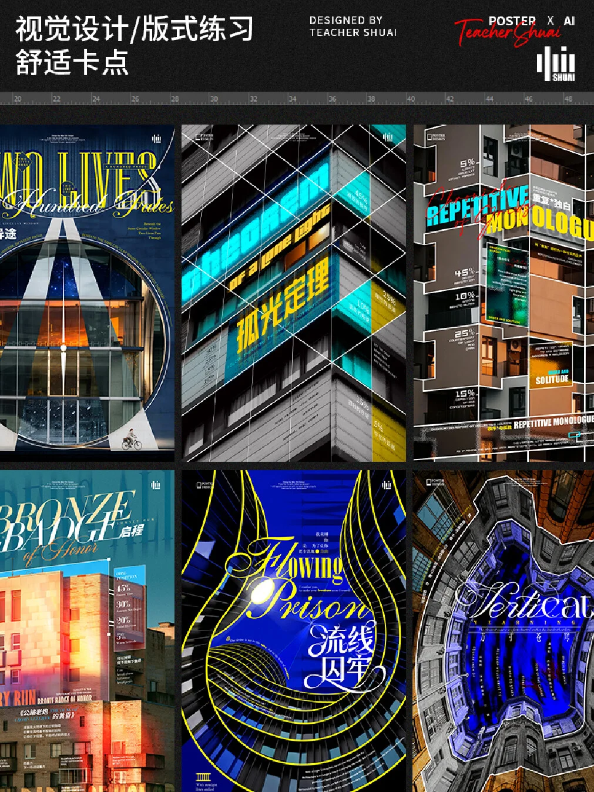
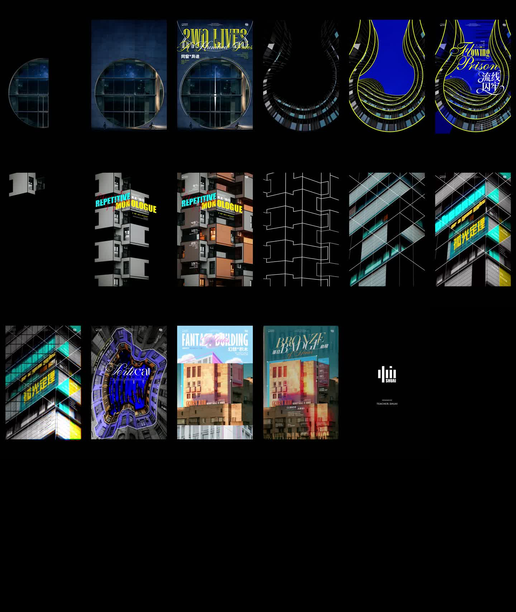

# 当海报设计遇上舒适卡点

- 作者：Teacher帅
- 链接：https://www.xiaohongshu.com/discovery/item/6b000087000000002a02bffe?app_platform=android&ignoreEngage=true&app_version=9.54.0&share_from_user_hidden=true&xsec_source=app_share&type=video&xsec_token=CBnJX3ut44J45vkyPqUkmWuX8i0EvfAD6ZlxaUYIPwwqc%3D&author_share=1&xhsshare=CopyLink&shareRedId=ODo0Qkc2Oj42NzUyOTgwNjc1OTg2OTc-&apptime=1795258210&share_id=ba9a7e0bacb94599946a3fb21e81faf2&share_channel=copy_link&track_code=6VgUqZlwSAB
- 抓取：2026-11-21
- 标签：#天才设计师 #好看 #排版设计 #海报设计 #视觉设计 #排版 #卡点

## 正文

#天才设计师[话题]# #好看[话题]# #排版设计[话题]# #海报设计[话题]# #视觉设计[话题]# #排版[话题]# #卡点[话题]#

## 素材

关键帧：[frame-01.jpg](frame-01.jpg) [frame-02.jpg](frame-02.jpg) [frame-03.jpg](frame-03.jpg) [frame-04.jpg](frame-04.jpg) [frame-05.jpg](frame-05.jpg) [frame-06.jpg](frame-06.jpg) [frame-07.jpg](frame-07.jpg) [frame-08.jpg](frame-08.jpg) [frame-09.jpg](frame-09.jpg) [frame-10.jpg](frame-10.jpg) [frame-11.jpg](frame-11.jpg) [frame-12.jpg](frame-12.jpg) [frame-13.jpg](frame-13.jpg) [frame-14.jpg](frame-14.jpg) [frame-15.jpg](frame-15.jpg) [frame-16.jpg](frame-16.jpg) [frame-17.jpg](frame-17.jpg) [frame-18.jpg](frame-18.jpg) [frame-19.jpg](frame-19.jpg) [frame-20.jpg](frame-20.jpg) [frame-21.jpg](frame-21.jpg) [frame-22.jpg](frame-22.jpg)
[视频](video.mp4)

## 学到的（Claude 看完素材后填写，并同步到 AESTHETIC.md）

- 6 张建筑海报：Two Lives（圆窗）、Flowing Prison 流线囚牢（弯曲楼板）、Repetitive Monologue（错落阳台）、孤光定理（斜线网格）、Vertical（天井）、Bronze Badge / Fantasy Building。
- 每张 4 拍：按建筑形状开窗 → 填照片 → 荧光描边沿曲线画出 → 标题卡点砸入。
- 关键：遮罩和描边路线都来自照片里的建筑线条，所以动画和画面是一体的。
- 海报之间硬切黑场，结尾白色 Logo「SHUAI」。
