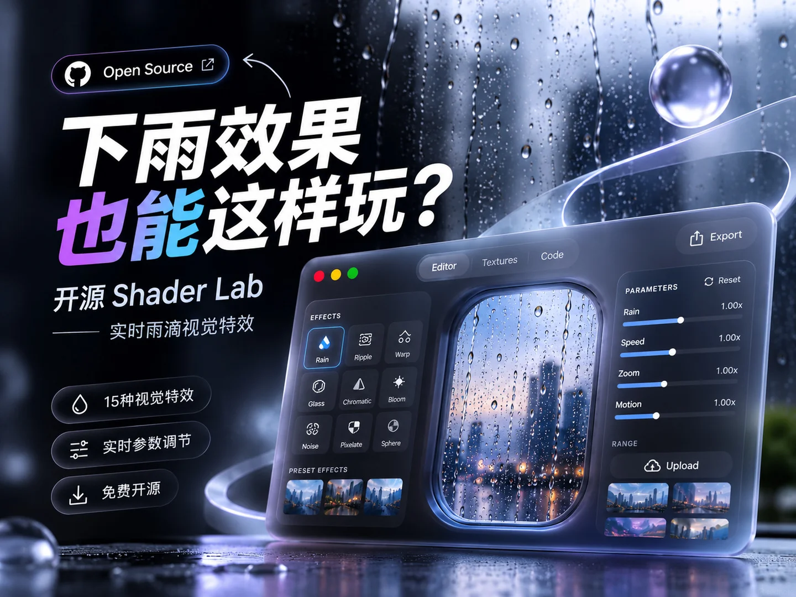
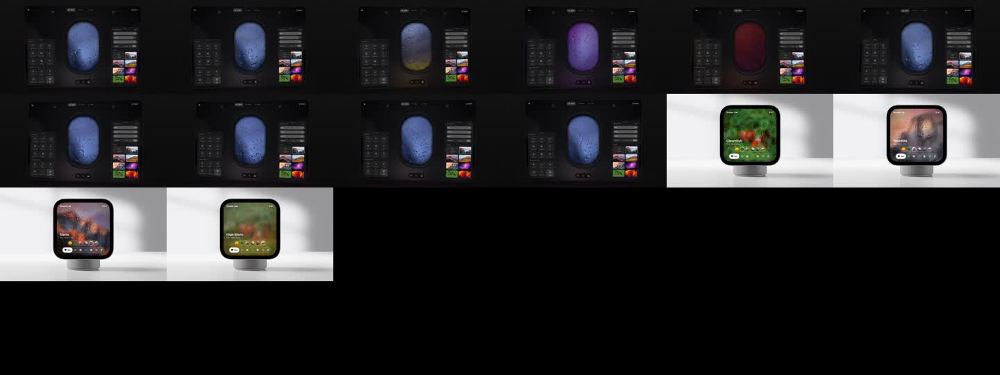

# 把下雨效果做出来了！这个开源项目太酷了

- 作者：象限设计局
- 链接：https://xhslink.cn/o/88WLj75xREm
- 抓取：2026-11-21
- 标签：#ShaderLab #开源项目 #UI设计 #视觉特效 #Shader #Metal #交互设计 #VibeCoding #程序员 #设计灵感

## 正文

🌧️ 如果手机屏幕可以模拟一扇正在下雨的窗户，会是什么效果？
	
今天发现一个很有意思的开源项目：Shader Lab，由开发者 Fede Sánchez 开源。
	
它不是普通的图片滤镜工具，而是一个实时 Metal Shader 视觉特效实验室。
	
最吸引我的就是它的 Rain 雨滴效果！
	
🔥 几个值得体验的功能：
	
01｜真实雨滴模拟
在玻璃表面生成动态雨滴，背景呈现自然的虚化效果，视觉上非常有沉浸感。
	
02｜多种窗户场景
支持 House（房屋）、Car（汽车）、Plane（飞机）三种窗口模式，不同场景会改变雨滴运动方向。
	
03｜15种视觉特效
除了 Rain，还包含 Ripple 波纹、Warp 扭曲、Fluted Glass 玻璃纹理、Chromatic 色彩偏移、Sphere 球体等效果。
	
04｜实时参数调节
可以直接调整特效参数，实时观察画面变化，不需要反复导出预览。
	
05｜导出专属壁纸
支持将生成的 Shader 效果导出为高清图片，保存到手机相册作为壁纸。
	
💡 更有意思的是：
这个项目已经开源，开发者还提供了 HomeView 虚拟机运行教程，可以自己搭建环境体验。
	
📦 项目名称：Shader Lab
	
🔗 GitHub：fedesanchez0/shader-lab
	
适合：
UI设计师、交互设计师、前端开发者、Shader技术爱好者，以及喜欢研究视觉特效的朋友。
	
有时候好的视觉体验，不只是界面排版，而是代码、光影和交互共同创造出来的。
	
#ShaderLab[话题]# #开源项目[话题]# #UI设计[话题]# #视觉特效[话题]# #Shader[话题]# #Metal[话题]# #交互设计[话题]# #VibeCoding[话题]# #程序员[话题]# #设计灵感[话题]#

## 素材

关键帧：[frame-01.jpg](frame-01.jpg) [frame-02.jpg](frame-02.jpg) [frame-03.jpg](frame-03.jpg) [frame-04.jpg](frame-04.jpg) [frame-05.jpg](frame-05.jpg) [frame-06.jpg](frame-06.jpg) [frame-07.jpg](frame-07.jpg) [frame-08.jpg](frame-08.jpg) [frame-09.jpg](frame-09.jpg)
[视频](video.mp4)

## 学到的（Claude 看完素材后填写，并同步到 AESTHETIC.md）

- 雨滴折射出清晰背景、背景虚化；开源 shader，复刻时先读源码。
