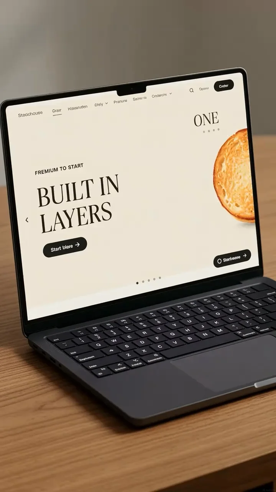
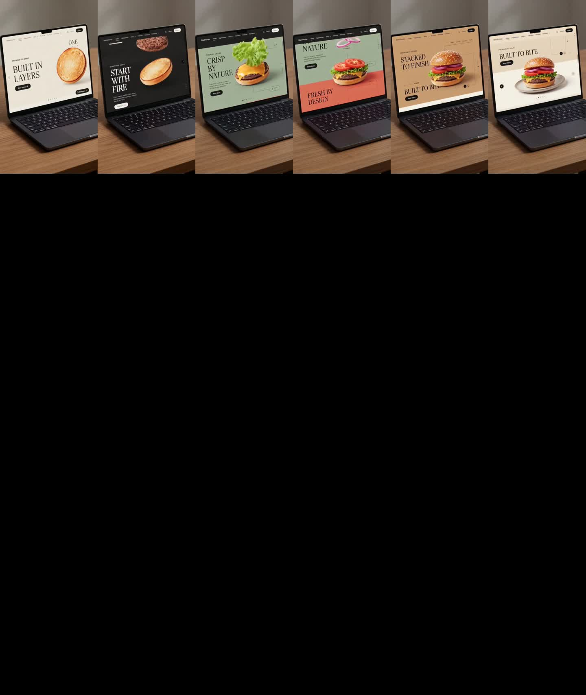

# 把汉堡做成网页动效🍔

- 作者：海淀掌管用户增长的神
- 链接：https://xhslink.cn/o/2QSGP1rScA6
- 抓取：2026-11-21
- 标签：#网页设计 #动效设计 #设计灵感 #clico

## 正文

把汉堡的食材一层层叠起来，变成一个网页动效。🍔
	
这个视觉思路很适合展示产品结构：让观众在几秒钟里看懂每一层。
	
来自 Clico的设计作品。
#网页设计[话题]#  #动效设计[话题]#  #设计灵感[话题]# #clico[话题]#

## 素材

关键帧：[frame-01.jpg](frame-01.jpg) [frame-02.jpg](frame-02.jpg) [frame-03.jpg](frame-03.jpg) [frame-04.jpg](frame-04.jpg)
[视频](video.mp4)

## 学到的（Claude 看完素材后填写，并同步到 AESTHETIC.md）

- 滚动一屏落一层食材、背景色幕布升起；演示 demos/burger-layers.html。
