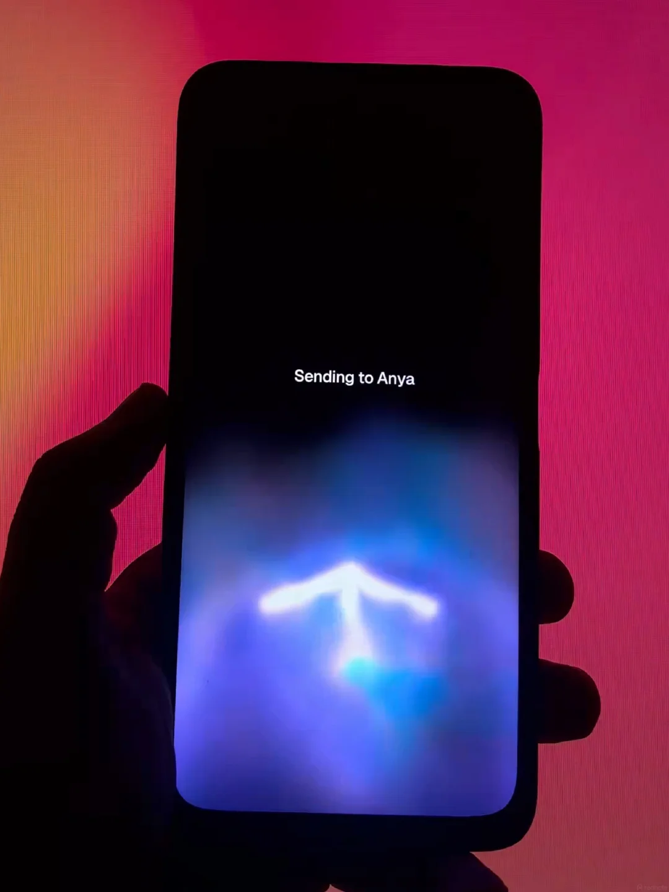
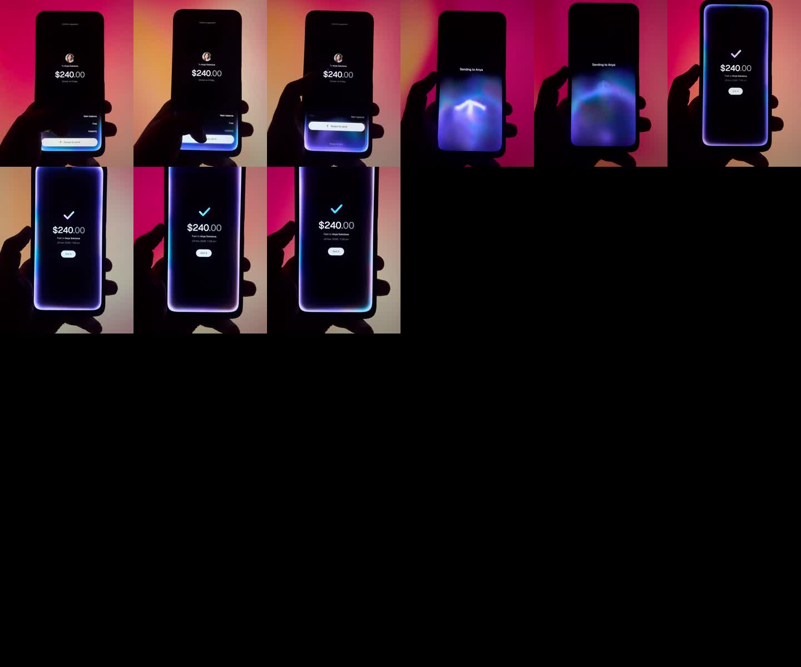

# 炫酷的交互动效分享

- 作者：屿安 designer
- 链接：https://xhslink.cn/o/63Kptqehfr2
- 抓取：2026-11-21
- 标签：#交互 #动效设计 #动态设计 #交互设计 #交互手势控制 #UI界面设计

## 正文

#交互[话题]# #动效设计[话题]# #动态设计[话题]# #交互设计[话题]# #交互手势控制[话题]# #UI界面设计[话题]#

## 素材

关键帧：[frame-01.jpg](frame-01.jpg) [frame-02.jpg](frame-02.jpg) [frame-03.jpg](frame-03.jpg) [frame-04.jpg](frame-04.jpg) [frame-05.jpg](frame-05.jpg)
[视频](video.mp4)

## 学到的（Claude 看完素材后填写，并同步到 AESTHETIC.md）

- 上滑 → 极光涌起 → 光环收到金额 → 屏幕边缘发光；归纳为「暗色界面 + 有生命的光」。
