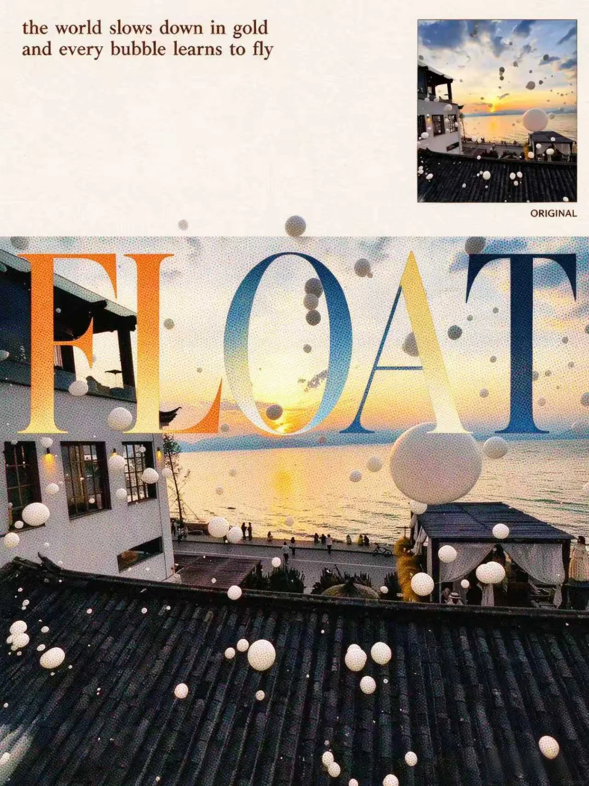
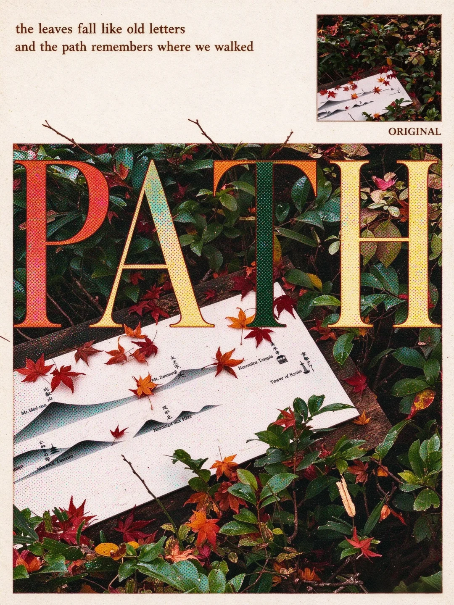
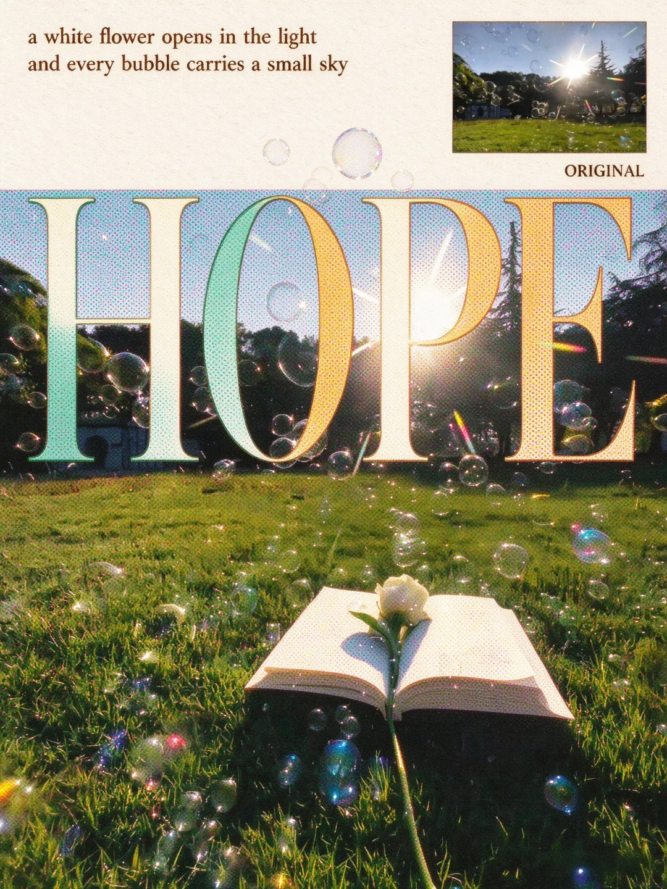
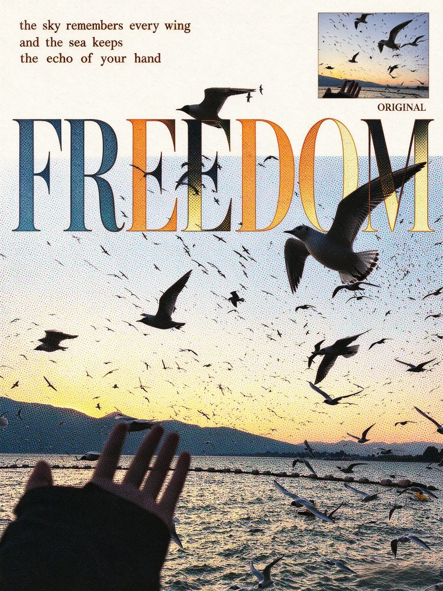
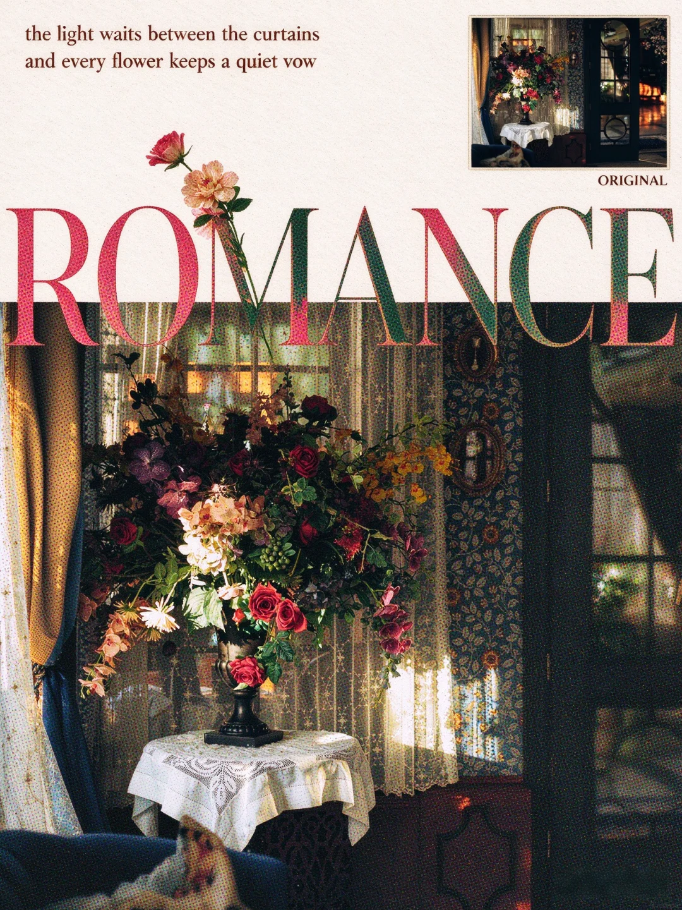
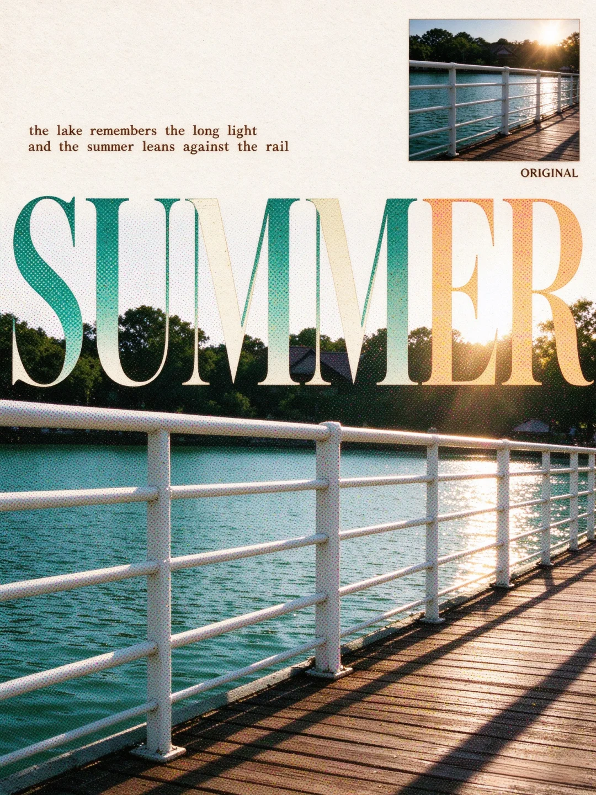
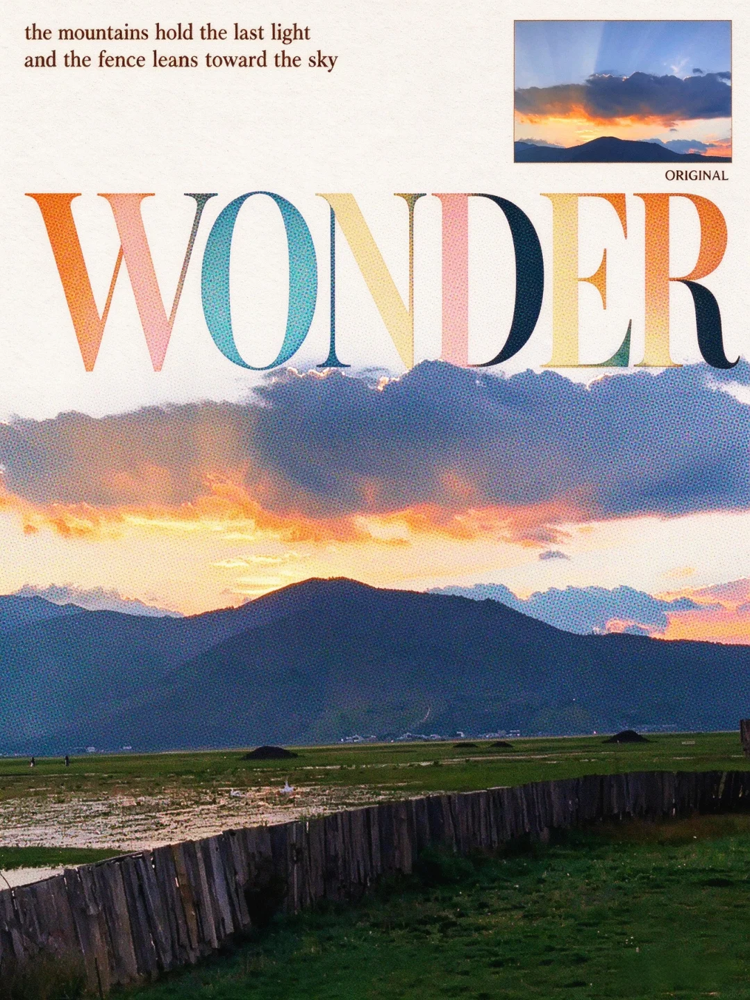
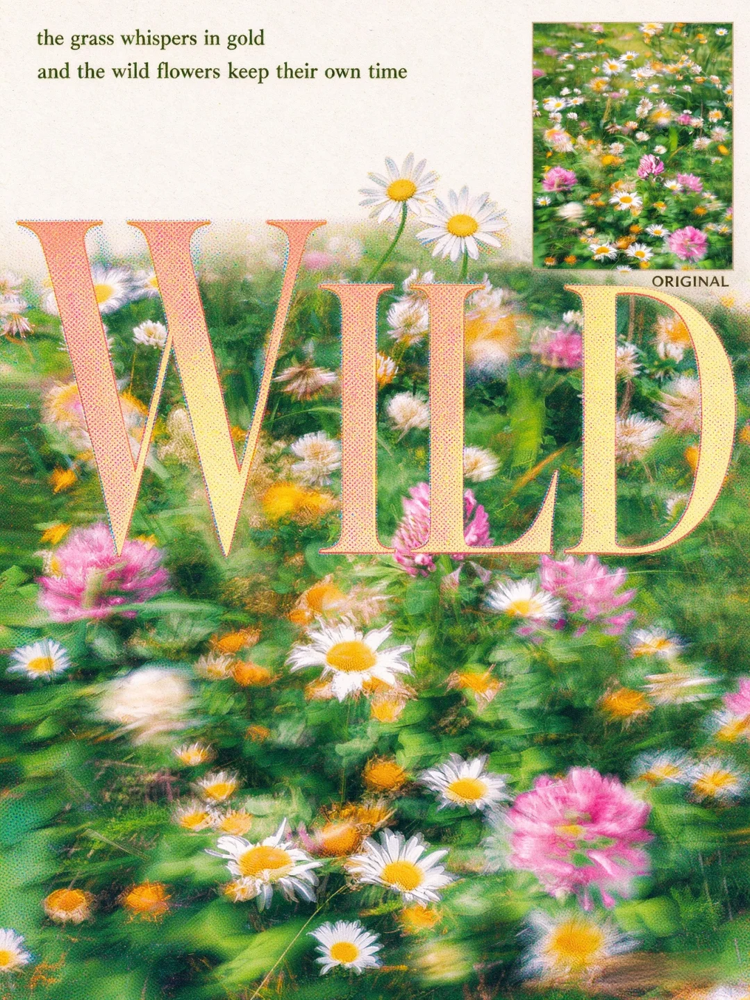

# 被这个提示词的审美惊艳到了✨

- 作者：小诺学姐聊科技
- 链接：https://www.xiaohongshu.com/discovery/item/6b01655f000000001b01f773?app_platform=android&ignoreEngage=true&app_version=9.54.0&share_from_user_hidden=true&xsec_source=app_share&type=normal&xsec_token=CBl-X_lZyj1sgNjjVPdEx484sc2TkqXhqNV4ll7iQtEy0%3D&author_share=1&xhsshare=CopyLink&shareRedId=ODo0Qkc2Oj42NzUyOTgwNjc1OTg2OTc-&apptime=1795258126&share_id=8f29d32b6b4c40c3b18d103603319ebb&share_channel=copy_link&track_code=2kf6RiHdpD3
- 抓取：2026-11-21
- 标签：#风景照高级感 #诗意复古海报 #杂志排版设计 #CMYK半调印刷 #AI绘画提示词 #照片留白构图 #打字机字体 #原图缩略图 #竖版3 #摄影与文字融合

## 正文

一直在想风景照能不能有比较丰富的一个表现，所以就有了这样一个提示词，真的被惊艳到了✨
✅提示词参考：
3:4竖版诗意复古杂志印刷海报，单张连续完整画面，禁止拼图、禁止样机。
固定布局规则
1. 画面上方约1/3：干净暖米白纸色留白，纹理清淡。左上放置两段简短诗意英文短句，采用小巧克制的打字机字体、同色系深色，文字简洁无多余内容。
2. 画面右上角：放置原图缩略图，宽度占画面15%-18%，完整保留原图比例、不裁切、不调色，搭配简约细边框，下方标注小字「ORIGINAL」，缩略图避开诗句与画面主体，互不重叠。
3. 画面正中部：放置单个简短大写衬线英文单词，超大字号、全屏横跨、高对比度。字体颜色从原图花瓣、枝叶、墙面、水体、果实中提取，贴合画面主色调、保证清晰可读，不强制使用蓝色。
4. 画面主体从下方原生场景自然向上延伸，完全保留原图视角、姿态、比例与物体相对关系，无身体、头颈扭曲变形。主体穿透巨型文字、适度遮挡部分笔画，顶端小幅越过文字、伸入上方留白区域，底部始终衔接原生场景、无悬浮断层，遮挡效果适中，保证大字清晰可辨。
印刷质感要求
大字区域与摄影画面，叠加细密清晰的CMYK彩色半调圆形网点，青、品、黄墨点轻微错位；阴影处网点密集、高光处网点稀疏。上方暖白留白区域干净极简、极少网点。保留照片真实质感与画面辨识度，强化原图自然光影氛围。
画面融合要求
整体画面无缝连贯，无生硬横向分割线、无矩形拼接块、无抠图白边、无僵硬渐变。依托主体轮廓、光影层次、色调变化与网点疏密，实现照片区域与留白区域的自然柔和过渡。
严格禁止项
禁止新增物体、多余装饰、水印、标题、划痕；仅保留CMYK半调网点，拒绝普通噪点、胶片颗粒；禁止主体拉伸扭曲、悬空脱离场景；禁止手绘插画、卡通风格；禁止裁切调色缩略图、图文重叠、文字模糊、布局混乱。
#风景照高级感[话题]# #诗意复古海报[话题]# #杂志排版设计[话题]# #CMYK半调印刷[话题]# #AI绘画提示词[话题]# #照片留白构图[话题]# #打字机字体[话题]# #原图缩略图[话题]# #竖版3[话题]#:4 #摄影与文字融合[话题]#

## 素材

## 学到的（Claude 看完素材后填写，并同步到 AESTHETIC.md）

- 一张连续画面，三层：上方留白（打字机小诗 + 右上原图缩略图 ORIGINAL）→ 中间横跨全幅的衬线大写单词 → 照片主体从下往上穿过大字。
- 大字每个字母单独取照片里的颜色，一个词里有蓝、橙、粉等好几种颜色，但都来自原图，所以不乱。
- CMYK 半调网点让 AI 图有印刷品的触感；放大看青、品、黄三色点轻微错位。
- 八张示例（FLOAT / PATH / HOPE / FREEDOM / ROMANCE / SUMMER / WONDER / WILD）都成立，换题材能用。
- 提示词全文见正文，也存进了图鉴条目 `cmyk-word-poster`。
